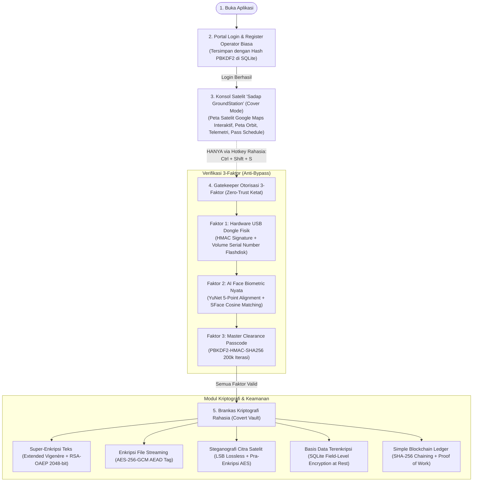

# Sadap GroundStation (Sadap Crypto Intelligence Suite)

Aplikasi Desktop Kriptografi Ganda (*Dual-Mode Chameleon Application*) berbasis **Python 3.13** dan **PyQt6** yang mengusung prinsip **_Plausible Deniability_** (Penyangkalan yang Masuk Akal).

Secara visual dan operasional publik, aplikasi ini adalah **Konsol Observasi Citra Satelit Bumi & Telemetri Geospasial** yang sah, padat, dan berfungsi penuh. Aplikasi dilengkapi portal login/register operator normal, penampil peta satelit interaktif Google Maps resolusi tinggi, pelacak orbit satelit nyata, jadwal lintasan (*AOS/LOS pass*), dan terminal log telemetri langsung.

**Tidak ada tombol rahasia apa pun di layar.** Akses ke **Brankas Kriptografi Hitam (*BlackOps Vault*)** hanya dapat dibuka melalui kombinasi tombol rahasia (**`Ctrl + Shift + S`**) yang dilindungi oleh **Autentikasi Multi-Faktor Zero-Trust Ketat** (Hardware USB Dongle Fisik + Biometrik Wajah AI Asli + Hash Passcode Master).

---

## 🌟 Arsitektur & Alur Operasional Sistem



---

## 🔑 Panduan Setup Kunci 3-Faktor (USB Dongle & Biometrik Wajah)

Sebelum dapat membuka brankas rahasia, Anda perlu menyiapkan **USB Flashdisk Fisik** dan **Wajah Operator Terdaftar**. Sistem menggunakan pendekatan **Zero-Trust Ketat** di mana brankas tidak dapat dibuka jika flashdisk tidak tercolok atau wajah tidak cocok (tanpa bypass/tanpa simulasi).

### 1. Cara Melakukan Inject Token ke Flashdisk USB (Faktor 1)

1. Tancapkan flashdisk USB fisik Anda ke salah satu port USB komputer.
2. Buka terminal (PowerShell) di folder projek dan jalankan tool injeksi:
   ```powershell
   python tools/setup_dongle.py
   ```
3. Tool akan memindai seluruh drive penyimpanan yang terhubung dan menandai flashdisk Anda dengan label `[REMOVABLE USB FLASHDISK]`:
   ```text
   [+] Memindai drive penyimpanan yang terpasang:
     [1] Drive: C:\    | Serial: 9E14-B1F3 | FS: NTFS   [Internal System Drive (C:)]
     [2] Drive: D:\    | Serial: 14D0-AE06 | FS: NTFS   [Fixed Internal Drive]
     [3] Drive: E:\    | Serial: 3A7C-889B | FS: FAT32  [REMOVABLE USB FLASHDISK]
   ```
4. Masukkan nomor pilihan flashdisk Anda (misal: `3`) atau ketik langsung huruf drive (misal: `E:\`).
5. Masukkan Callsign Operator (misal: `SADAP-ALPHA-01`).
6. Tool akan secara otomatis:
   - Membaca **Volume Serial Number** fisik dari flashdisk tersebut.
   - Menghasilkan token kriptografi terotentikasi HMAC-SHA256.
   - Menulis berkas kunci `sadap.sig` langsung ke root flashdisk (`E:\sadap.sig`).
7. **Selesai!** Flashdisk Anda kini resmi menjadi Kunci Keras Faktor 1.
   > **Catatan Keamanan**: Jika file token tersebut disalin (*copy-paste*) ke flashdisk lain atau harddisk lokal, verifikasi akan otomatis gagal karena serial hardware tidak cocok (*hardware-serial binding*).
   >
   > **Deteksi Otomatis Live (Real-Time)**: Dialog otorisasi dilengkapi detektor otomatis yang aktif memindai bus penyimpanan setiap 600 ms. Begitu flashdisk dicabut, status langsung seketika berubah menjadi merah (*❌ No Authorized USB Dongle Detected*); dan begitu flashdisk dicolokkan kembali, status langsung seketika berubah menjadi hijau (*✅ Dongle Valid*) secara otomatis tanpa perlu menekan tombol Re-Scan.

---

### 2. Cara Mendaftarkan Wajah Biometrik AI (Faktor 2)

Sistem menggunakan model deep neural network canggih **YuNet** dan **SFace** (100% offline lokal) untuk mengekstrak 128-D embedding wajah dan memverifikasinya menggunakan *Cosine Similarity*.

1. Jalankan tool pendaftaran wajah:
   ```powershell
   python tools/register_face.py
   ```
2. Masukkan nama/callsign operator (misal: `Sadap Commander`).
3. Pilih salah satu metode pendaftaran:
   * **Opsi [1] — Ambil Langsung via Kamera Webcam**:
     - Jendela kamera webcam akan terbuka.
     - Posisikan wajah Anda tepat di depan kamera hingga muncul kotak hijau (*WAJAH TERDETEKSI*).
     - Tekan tombol **SPASI** untuk mengambil foto dan mengekstrak template biometrik.
   * **Opsi [2] — Ambil dari Berkas Foto Potret (PNG/JPG)**:
     - Masukkan path lengkap ke berkas foto potret wajah Anda (misal: `C:\Users\User\Pictures\my_photo.jpg`).
     - Tool akan mendeteksi wajah di dalam foto dan mengekstrak vektor fiturnya.
4. Template biometrik wajah akan disimpan terenkripsi di `data/keys/face_template.npz`.
5. **Selesai!** Pada dialog autentikasi, Anda cukup menyalakan kamera atau mengklik tombol *"Verify via Photo..."* untuk mencocokkan wajah Anda secara instan.

---

### 3. Passcode Master Clearance (Faktor 3)

Passcode master diverifikasi menggunakan derivasi kunci **PBKDF2-HMAC-SHA256** (200.000 iterasi dengan salt kriptografis unik).
* **Default Master Code**: `Sadap-Commander-2026!`

---

## 🛰️ Fitur Halaman Cover (Sadap GroundStation)

Halaman Cover dirancang sangat meyakinkan sebagai perangkat lunak stasiun bumi resmi:
1. **Peta Satelit Interaktif Google Maps & Earth Observation**:
   - Menampilkan citra satelit Google Earth hybrid resolusi tinggi secara langsung.
   - Interaksi penuh: drag/pan, zoom dengan scroll wheel mouse, beralih layer (*Google Hybrid*, *Google Sat*, *ESRI World Imagery*, *OpenStreetMap*).
   - Tombol pintas taktis melayang untuk melompat cepat ke target observasi strategis (*Jakarta*, *IKN Nusantara*, *Krakatau*, *Tokyo*, *Indonesia*).
   - HUD koordinat dinamis yang membaca posisi target reticle bidik secara realtime.
2. **Pelacak Satelit Nyata & Peta Orbit Geospasial**:
   - Pelacakan satelit riil: **SADAP-SV09**, **ISS (Stasiun Luar Angkasa Internasional)**, **Landsat-9**, **Sentinel-2A**, dan **NOAA-20**.
   - Peta radar animasi koordinat lintang dan bujur realtime.
3. **Panel Sensor Telemetri & Daya**:
   - Menampilkan *Orbit Altitude*, *Ground Velocity*, *Downlink Frequency*, *Antenna Azimuth*, *Signal SNR*, daya panel surya (*Solar Array Watts*), dan indikator baterai bus satelit.
4. **Jadwal Lintasan Orbit (*AOS/LOS Pass Prediction Schedule*)**:
   - Tabel prediksi waktu melintas satelit di atas stasiun bumi (*Acquisition of Signal*, *Max Elevation*, *Duration*).
5. **Terminal Log Telemetri Ringkas (*Compact Live Stream*)**:
   - Streaming bingkai data telemetri yang ter-dekode secara langsung dan bergulir rapi.
6. **Sesi Operator**:
   - Menampilkan identitas operator yang sedang bertugas (*Callsign* & *Mission Role*) dan tombol *Sign Out*.

---

## 🔐 Spesifikasi Modul Kriptografi & Keamanan

* **Autentikasi Operator Biasa**: Disimpan dalam tabel `station_operators` dengan hash **PBKDF2-HMAC-SHA256** dan *salt* unik 16-byte.
* **USB Hardware Dongle**: Memverifikasi *Volume Serial Number* fisik perangkat keras flashdisk dan *HMAC-SHA256 signature token* pada file `sadap.sig` (dan `aerosat.sig`).
* **Biometrik Wajah AI**: Menggunakan model Deep Learning mutakhir **OpenCV 5 YuNet** (deteksi & landmark 5-titik) dan **SFace** (128-D embedding & *cosine similarity*). Berjalan **100% offline** tanpa ketergantungan internet.
* **Super-Enkripsi Teks**: Kombinasi kriptografi klasik **Extended Vigenère Cipher** (modulo 256) dan modern **RSA-OAEP 2048-bit** dengan mekanisme pemecahan blok otomatis (*chunking*).
* **Enkripsi File AES**: Menggunakan **AES-256-GCM (Authenticated Encryption with Associated Data)** dengan streaming buffer 64 KB, proteksi pemalsuan tag, dan pemulihan nama berkas asli.
* **Steganografi Citra LSB**: Vektorisasi NumPy instan untuk menyisipkan pesan/berkas rahasia ke bit LSB kanal warna RGB citra satelit lossless (PNG/BMP) dengan metrik PSNR > 60 dB (tak kasat mata).
* **Basis Data Terenkripsi**: SQLite `data/vault.db` dengan *field-level encryption* otomatis menggunakan AES-256-GCM.
* **Simple Blockchain**: Rantai blok dengan hashing SHA-256, konsensus *Proof of Work (PoW)*, notarisasi sidik jari file, dan deteksi pemalsuan data seketika (`is_chain_valid`).

---

## 🚀 Panduan Menjalankan Aplikasi

### 1. Menjalankan Aplikasi
```powershell
python main.py
```

### 2. Kredensial Akses Bawaan (Default Demo Credentials)

| Layanan | Username / Callsign | Password / Passcode | Keterangan |
| :--- | :--- | :--- | :--- |
| **Portal Operator Biasa** | `operator` | `operator123` | Masuk ke Cover Stasiun Satelit biasa (atau buat akun baru di tab Register) |
| **Passcode Master Vault** | `COMMANDER-01` | `Sadap-Commander-2026!` | Digunakan pada dialog otorisasi 3-faktor gerbang rahasia |

---

## 🎮 Skenario Penggunaan & Pengujian Lengkap

1. **Langkah 1: Masuk Melalui Portal Operator**
   - Jalankan `python main.py`. Jendela **Operator Sign In** akan muncul dengan isian kosong.
   - Masukkan username `operator` dan password `operator123`.
   - Klik **"Sign In to Ground Station"**.
2. **Langkah 2: Menjelajahi Cover Mode Satelit**
   - Konsol stasiun satelit **Sadap GroundStation** akan terbuka dalam mode fullscreen / maximized.
   - Peta Google Maps Satelit interaktif dapat digeser (*drag*) dan diperbesar (*zoom*).
   - Perhatikan bahwa **tidak ada tombol rahasia apa pun** di antarmuka ini.
3. **Langkah 3: Memicu Gerbang Rahasia (The Secret Trigger)**
   - Tekan kombinasi tombol rahasia pada keyboard:
     ```text
     Ctrl + Shift + S
     ```
   - Modal otorisasi **Zero-Trust 3-Factor** akan muncul:
     - **Faktor 1 (USB)**: Harus ada USB flashdisk tercolok yang sudah diinjeksi via `tools/setup_dongle.py`. Jika tidak ada flashdisk tercolok, status berwarna merah: `❌ No Authorized USB Dongle Detected`.
     - **Faktor 2 (Face)**: Nyalakan webcam atau klik `Verify via Photo...` untuk memverifikasi wajah sesuai template yang didaftarkan via `tools/register_face.py`.
     - **Faktor 3 (Passcode)**: Ketik passcode master `Sadap-Commander-2026!`.
   - Klik **"🔓 Unlock Classified Vault"**.
4. **Langkah 4: Operasi Brankas Kriptografi**
   - Jendela stasiun satelit disembunyikan dan jendela **Sadap Classified Vault** akan terbuka.
   - Gunakan 5 tab instrumen kripto:
     - 📜 **Super-Cipher**: Enkripsi dan dekripsi pesan rahasia ganda (Vigenère + RSA).
     - 📁 **File AES-256**: Enkripsi berkas apa saja menjadi format biner `.enc` dan dekripsi kembali.
     - 🛰️ **Stego Lab**: Sisipkan pesan rahasia ke dalam citra satelit dan ekstrak kembali.
     - 🗄️ **DB Vault**: Akses tabel SQLite yang terenkripsi penuh di disk.
     - ⛓️ **Blockchain**: Lakukan audit integritas rantai blok dan daftarkan sidik jari berkas.
5. **Langkah 5: Mengunci Kembali ke Mode Cover**
   - Klik tombol merah **"🔒 Lock & Return to Cover Mode"** di pojok kanan atas.
   - Brankas rahasia langsung tertutup dan jendela stasiun satelit muncul kembali tanpa jejak.

---

## 🧪 Pengujian Unit & Integrasi Otomatis

Seluruh modul telah diuji menggunakan **53 automated unit tests** dengan hasil kelulusan **100%**:

```powershell
# Menjalankan seluruh 53 unit test proyek
python -m unittest discover tests

# Menjalankan pengujian skenario misi End-to-End
python -m unittest tests/test_end_to_end.py
```
