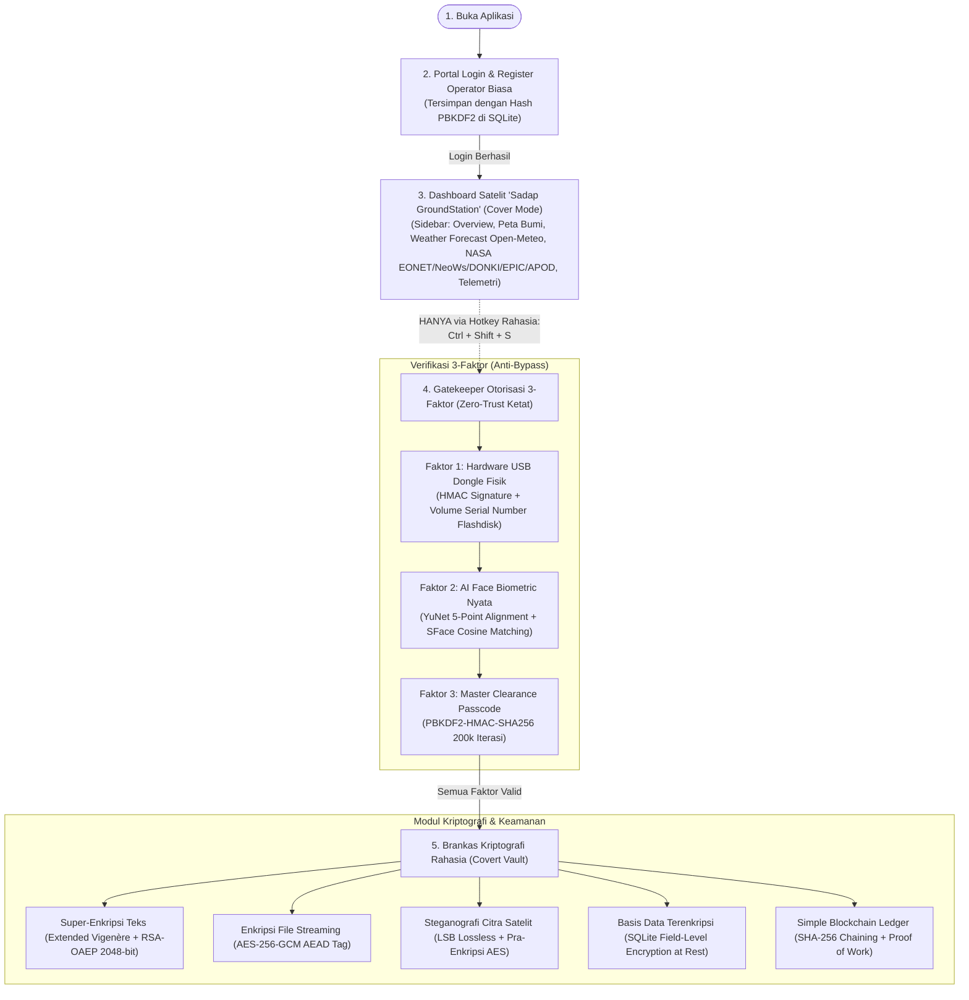

# Sadap GroundStation (Sadap Crypto Intelligence Suite)

Aplikasi Desktop Kriptografi Ganda (*Dual-Mode Chameleon Application*) berbasis **Python 3.13** dan **PyQt6** yang mengusung prinsip **_Plausible Deniability_** (Penyangkalan yang Masuk Akal).

Secara visual dan operasional publik, aplikasi ini adalah **Konsol Observasi Citra Satelit Bumi & Telemetri Geospasial** yang sah, padat, dan berfungsi penuh. Aplikasi dilengkapi portal login/register operator normal, dashboard sidebar dengan data NASA Open APIs dan prakiraan cuaca Open-Meteo, penampil peta satelit interaktif Google Maps resolusi tinggi, pelacak orbit satelit nyata, jadwal lintasan (*AOS/LOS pass*), dan terminal log telemetri langsung.

> **Catatan penamaan:** *AeroSat GroundStation* adalah nama proyek di dokumentasi akademik, sedangkan **Sadap GroundStation** adalah nama produk yang tampil di aplikasi dan README ini.

**Tidak ada tombol rahasia apa pun di layar.** Akses ke **Brankas Kriptografi Hitam (*BlackOps Vault*)** hanya dapat dibuka melalui kombinasi tombol rahasia (**`Ctrl + Shift + S`**) yang dilindungi oleh **Autentikasi Multi-Faktor Zero-Trust Ketat** (Hardware USB Dongle Fisik + Biometrik Wajah AI Asli + Hash Passcode Master).

---

## 🌟 Arsitektur & Alur Operasional Sistem



---

## 🌐 Konfigurasi API Publik (Opsional)

Dashboard cover menampilkan lima sumber data NASA: **EONET**, **NeoWs**, **DONKI**, **EPIC**, dan **APOD**. Aplikasi sudah bisa berjalan dengan `DEMO_KEY`; untuk kuota dan stabilitas demo yang lebih baik:

```powershell
copy .env.example .env
```

Lalu edit `.env` dan isi `NASA_API_KEY` dengan key dari <https://api.nasa.gov/>. Key dibaca sekali saat startup melalui `config/settings.py`. Respons disimpan sementara di `data/cache/nasa/` sehingga dashboard tetap punya data saat internet terputus.

> **Catatan penyimpanan**: Seluruh folder `data/` (**termasuk cache, template wajah, credential hash, kunci RSA, dan vault DB**) sengaja **tidak lagi ter-track Git** — hanya file lokal Anda yang menyimpannya. Saat clone pertama kali, aplikasi membuat ulang folder, hash passcode default, keypair RSA, dan database secara otomatis. Wajah operator harus didaftarkan ulang via `🧬 Face Enrollment` (dalam brankas) atau `python tools/register_face.py`. Jangan pernah commit atau force-add isi `data/`.

Menu **Weather Forecast** memakai [Open-Meteo](https://open-meteo.com/) dan **tidak memerlukan API key** (forecast + geocoding global). Lokasi bisa dipilih lewat **preset**, **pencarian nama lokasi**, **input koordinat manual (lat/lon)**, atau **peta mini dengan pin di titik tengah peta** (“Pilih di Peta…”). Data prakiraan di-cache per koordinat di `data/cache/weather/` (TTL 10 menit). Tombol **Gunakan Target Peta** menyamakan lokasi forecast dengan titik tengah peta yang sedang ditampilkan di Earth Observation.

---

## 🔑 Panduan Setup Kunci 3-Faktor (USB Dongle & Biometrik Wajah)

Sebelum dapat membuka brankas rahasia, Anda perlu menyiapkan **USB Flashdisk Fisik** dan **Wajah Operator Terdaftar**. Sistem menggunakan pendekatan **Zero-Trust Ketat** di mana brankas tidak dapat dibuka jika flashdisk tidak tercolok atau wajah tidak cocok (tanpa bypass/tanpa simulasi).

### 1. Cara Melakukan Inject Token ke Flashdisk USB (Faktor 1)

1. Tancapkan flashdisk USB fisik Anda ke salah satu port USB komputer.
2. Buka terminal (PowerShell) di folder projek dan jalankan tool injeksi:
   ```powershell
   python tools/setup_dongle.py
   ```
3. Tool akan memindai seluruh drive penyimpanan yang terhubung dan menandai flashdisk Anda dengan label `[REMOVABLE USB FLASHDISK]`:
   ```text
   [+] Memindai drive penyimpanan yang terpasang:
     [1] Drive: C:\    | Serial: 9E14-B1F3 | FS: NTFS   [Internal System Drive (C:)]
     [2] Drive: D:\    | Serial: 14D0-AE06 | FS: NTFS   [Fixed Internal Drive]
     [3] Drive: E:\    | Serial: 3A7C-889B | FS: FAT32  [REMOVABLE USB FLASHDISK]
   ```
4. Masukkan nomor pilihan flashdisk Anda (misal: `3`) atau ketik langsung huruf drive (misal: `E:\`).
5. Masukkan Callsign Operator (misal: `SADAP-ALPHA-01`).
6. Tool akan secara otomatis:
   - Membaca **Volume Serial Number** fisik dari flashdisk tersebut.
   - Menghasilkan token kriptografi terotentikasi HMAC-SHA256.
   - Menulis berkas kunci `sadap.sig` langsung ke root flashdisk (`E:\sadap.sig`).
7. **Selesai!** Flashdisk Anda kini resmi menjadi Kunci Keras Faktor 1.
   > **Catatan Keamanan**: Jika file token tersebut disalin (*copy-paste*) ke flashdisk lain atau harddisk lokal, verifikasi akan otomatis gagal karena serial hardware tidak cocok (*hardware-serial binding*).
   >
   > **Deteksi Otomatis Live (Real-Time)**: Dialog otorisasi dilengkapi detektor otomatis yang aktif memindai bus penyimpanan setiap 600 ms. Begitu flashdisk dicabut, status langsung seketika berubah menjadi merah (*❌ No Authorized USB Dongle Detected*); dan begitu flashdisk dicolokkan kembali, status langsung seketika berubah menjadi hijau (*✅ Dongle Valid*) secara otomatis tanpa perlu menekan tombol Re-Scan.
    >
    > **Auto-Lock Brankas**: Setelah brankas terbuka, status dongle tetap dipantau setiap detik. Jika dongle dicabut **atau diganti dengan token lain**, brankas langsung dikunci otomatis dan aplikasi kembali ke mode Cover (audit: `AUTH_DONGLE_REMOVED_AUTO_LOCK`).

---

### 2. Cara Mendaftarkan Wajah Biometrik AI (Faktor 2)

Sistem menggunakan **YuNet** + **SFace** (100% offline lokal) untuk mengekstrak 128-D embedding wajah dan mencocokkannya dengan *Cosine Similarity*. **Beberapa wajah operator dapat didaftarkan**; salah satu yang cocok akan membuka brankas.

Pendaftaran/pengelolaan hanya tersedia **di dalam Secret Dashboard** (tab `🧬 Face Enrollment`) atau lewat CLI:

1. Buka brankas, lalu pilih tab `🧬 Face Enrollment`.
2. Nyalakan kamera, masukkan nama/callsign operator dan **passphrase enkripsi snapshot**, lalu klik **Capture & Daftar Wajah**.
3. Tab tersebut juga menyediakan **Lihat Snapshot** (passphrase yang sama) dan **Hapus Operator**.

Alternatif CLI (**kamera saja**, tanpa opsi foto):

```powershell
python tools/register_face.py
```

- Menu: daftar/perbarui wajah, lihat daftar operator, hapus operator.
- Passphrase diminta lewat prompt tersembunyi (`getpass`) dan tidak pernah disimpan.

Penyimpanan:

- Embedding semua operator: `data/keys/face_template.npz` (format v2, otomatis bermigrasi dari format lama).
- Snapshot wajah: `data/keys/faces/<nama>_<timestamp>.png.enc`, **dienkripsi AES-256-GCM** memakai `core/crypto/file_aes.py`. PNG plaintext tidak pernah ditinggalkan di disk.

Pada dialog autentikasi, nyalakan kamera — **tidak ada verifikasi via foto**.

---

### 3. Passcode Master Clearance (Faktor 3)

Passcode master diverifikasi menggunakan derivasi kunci **PBKDF2-HMAC-SHA256** (200.000 iterasi dengan salt kriptografis unik) yang tersimpan pada `data/keys/master_credential.hash`.
* **Default awal (fresh install)**: `Sadap-Commander-2026!` — **segera ganti** setelah instalasi (hash lokal tidak pernah disimpan di Git).

#### Cara Mengganti Master Passcode:
Anda dapat mengganti Master Passcode kapan saja melalui **dua cara**:

1. **Cara 1: Melalui GUI di dalam Brankas Rahasia (Covert Vault)**:
   - Buka brankas rahasia (`Ctrl + Shift + S` $\to$ selesaikan 3-Faktor $\to$ Unlock).
   - Di bar atas (*header*) sebelah tombol merah, klik tombol **`🔑 Change Master Code`**.
   - Masukkan *Current Passcode*, *New Passcode* (min 8 karakter), dan konfirmasi.
   - Klik **💾 Save New Passcode**. Perubahan langsung tersimpan ke hash dan dicatat di audit log basis data terenkripsi.

2. **Cara 2: Melalui Terminal (CLI Utility)**:
   - Buka terminal PowerShell dan jalankan:
     ```powershell
     python tools/change_mastercode.py
     ```
   - Masukkan passcode lama, lalu ketik passcode baru dan konfirmasi.
   - *Jika Anda lupa passcode lama*, Anda dapat menggunakan flag reset langsung:
     ```powershell
     python tools/change_mastercode.py --reset
     ```

---

## 🛰️ Fitur Dashboard Cover (Sadap GroundStation)

Halaman Cover dirancang sangat meyakinkan sebagai perangkat lunak stasiun bumi resmi. Navigasi menggunakan sidebar kiri; panel telemetri asli berada di halaman **Satellite Telemetry**:
1. **Peta Satelit Interaktif Google Maps & Earth Observation**:
   - Menampilkan citra satelit Google Earth hybrid resolusi tinggi secara langsung.
   - Interaksi penuh: drag/pan, zoom dengan scroll wheel mouse, beralih layer (*Google Hybrid*, *Google Sat*, *ESRI World Imagery*, *OpenStreetMap*).
   - Tombol pintas taktis melayang untuk melompat cepat ke target observasi dalam negeri (*Jakarta*, *IKN*, *Surabaya*, *Bandung*, *Medan*, *Makassar*, *Denpasar*, *Indonesia*).
   - HUD koordinat dinamis yang membaca posisi target reticle bidik secara realtime.
2. **Weather Forecast (Open-Meteo, global)**:
   - Prakiraan kondisi terkini, suhu, kelembapan, angin, dan curah hujan untuk lokasi mana pun di dunia.
   - Pilih lokasi via preset kota, **pencarian nama lokasi (geocoding)**, **input koordinat manual**, atau **peta mini dengan pin di titik tengah peta**.
   - Tabel prakiraan 7 hari dan per 3 jam dengan zona waktu lokal otomatis.
   - Tombol **Gunakan Target Peta** untuk menyamakan lokasi forecast dengan titik tengah peta Earth Observation.
3. **Pelacak Satelit Nyata & Peta Orbit Geospasial**:
   - Pelacakan satelit riil: **SADAP-SV09**, **ISS (Stasiun Luar Angkasa Internasional)**, **Landsat-9**, **Sentinel-2A**, dan **NOAA-20**.
   - Peta radar animasi koordinat lintang dan bujur realtime.
4. **Panel Sensor Telemetri & Daya**:
   - Menampilkan *Orbit Altitude*, *Ground Velocity*, *Downlink Frequency*, *Antenna Azimuth*, *Signal SNR*, daya panel surya (*Solar Array Watts*), dan indikator baterai bus satelit.
5. **Jadwal Lintasan Orbit (*AOS/LOS Pass Prediction Schedule*)**:
   - Tabel prediksi waktu melintas satelit di atas stasiun bumi (*Acquisition of Signal*, *Max Elevation*, *Duration*).
6. **Terminal Log Telemetri Ringkas (*Compact Live Stream*)**:
   - Streaming bingkai data telemetri yang ter-dekode secara langsung dan bergulir rapi.
7. **Modul Data NASA Open APIs**:
   - **Overview**: kartu ringkasan NeoWs, EONET, dan DONKI yang terisi otomatis saat modul terkait dimuat.
   - **Natural Events**: EONET kejadian alam aktif; baris bisa langsung "Locate on Map".
   - **Space Weather**: notifikasi DONKI 7 hari terakhir.
   - **Near-Earth Objects**: feed NeoWs dengan diameter, jarak, kecepatan, dan flag bahaya.
   - **Earth Imagery**: citra Bumi EPIC dan APOD dengan cache lokal.
8. **Sesi Operator**:
   - Menampilkan identitas operator yang sedang bertugas (*Callsign* & *Mission Role*) dan tombol *Sign Out*.

---

## 🔐 Spesifikasi Modul Kriptografi & Keamanan

* **Autentikasi Operator Biasa**: Disimpan dalam tabel `station_operators` dengan hash **PBKDF2-HMAC-SHA256** dan *salt* unik 16-byte.
* **USB Hardware Dongle**: Memverifikasi *Volume Serial Number* fisik perangkat keras flashdisk dan *HMAC-SHA256 signature token* pada file `sadap.sig` (dan `aerosat.sig`).
* **Biometrik Wajah AI**: Menggunakan model Deep Learning mutakhir **OpenCV 5 YuNet** (deteksi & landmark 5-titik) dan **SFace** (128-D embedding & *cosine similarity*). Berjalan **100% offline** tanpa ketergantungan internet.
* **Super-Enkripsi Teks**: Kombinasi kriptografi klasik **Extended Vigenère Cipher** (modulo 256) dan modern **RSA-OAEP 2048-bit** dengan mekanisme pemecahan blok otomatis (*chunking*).
* **Enkripsi File AES**: Menggunakan **AES-256-GCM (Authenticated Encryption with Associated Data)** dengan streaming buffer 64 KB, proteksi pemalsuan tag, dan pemulihan nama berkas asli.
* **Steganografi Citra LSB**: Vektorisasi NumPy instan untuk menyisipkan pesan/berkas rahasia ke bit LSB kanal warna RGB citra satelit lossless (PNG/BMP) dengan metrik PSNR > 60 dB (tak kasat mata).
* **Basis Data Terenkripsi**: SQLite `data/vault.db` dengan *field-level encryption* otomatis menggunakan AES-256-GCM.
* **Simple Blockchain**: Rantai blok dengan hashing SHA-256, konsensus *Proof of Work (PoW)*, notarisasi sidik jari file, dan deteksi pemalsuan data seketika (`is_chain_valid`).

---

## 🚀 Panduan Menjalankan Aplikasi

### 1. Menjalankan Aplikasi
```powershell
python main.py
```

### 2. Kredensial Akses Bawaan (Default Demo Credentials)

| Layanan | Username / Callsign | Password / Passcode | Keterangan |
| :--- | :--- | :--- | :--- |
| **Portal Operator Biasa** | `operator` | `operator123` | Masuk ke Cover Stasiun Satelit biasa (atau buat akun baru di tab Register) |
| **Passcode Master Vault** | `COMMANDER-01` | `Sadap-Commander-2026!` *(default awal, segera ganti)* | Digunakan pada dialog otorisasi 3-faktor gerbang rahasia |

---

## 🎮 Skenario Penggunaan & Pengujian Lengkap

1. **Langkah 1: Masuk Melalui Portal Operator**
   - Jalankan `python main.py`. Jendela **Operator Sign In** akan muncul dengan isian kosong.
   - Masukkan username `operator` dan password `operator123`.
   - Klik **"Sign In to Ground Station"**.
2. **Langkah 2: Menjelajahi Cover Mode Satelit**
   - Konsol stasiun satelit **Sadap GroundStation** akan terbuka dalam mode fullscreen / maximized.
   - Peta Google Maps Satelit interaktif dapat digeser (*drag*) dan diperbesar (*zoom*).
   - Perhatikan bahwa **tidak ada tombol rahasia apa pun** di antarmuka ini.
3. **Langkah 3: Memicu Gerbang Rahasia (The Secret Trigger)**
   - Tekan kombinasi tombol rahasia pada keyboard:
     ```text
     Ctrl + Shift + S
     ```
   - Modal otorisasi **Zero-Trust 3-Factor** akan muncul:
     - **Faktor 1 (USB)**: Harus ada USB flashdisk tercolok yang sudah diinjeksi via `tools/setup_dongle.py`. Jika tidak ada flashdisk tercolok, status berwarna merah: `❌ No Authorized USB Dongle Detected`.
     - **Faktor 2 (Face)**: Nyalakan webcam. Wajah Anda dicocokkan dengan **semua** operator yang terdaftar; tidak ada opsi verifikasi via foto.
         - **Faktor 3 (Passcode)**: Ketik passcode master Anda (default awal fresh install: Sadap-Commander-2026!, segera ganti).
   - Klik **"🔓 Unlock Classified Vault"**.
4. **Langkah 4: Operasi Brankas Kriptografi**
   - Jendela stasiun satelit disembunyikan dan jendela **Sadap Classified Vault** akan terbuka.
   - Gunakan 6 tab instrumen kripto:
     - 📜 **Super-Cipher**: Enkripsi dan dekripsi pesan rahasia ganda (Vigenère + RSA).
     - 📁 **File AES-256**: Enkripsi berkas apa saja menjadi format biner `.enc` dan dekripsi kembali.
     - 🛰️ **Stego Lab**: Sisipkan pesan rahasia ke dalam citra satelit dan ekstrak kembali.
     - 🗄️ **DB Vault**: Akses tabel SQLite yang terenkripsi penuh di disk.
     - ⛓️ **Blockchain**: Lakukan audit integritas rantai blok dan daftarkan sidik jari berkas.
      - 🧬 **Face Enrollment**: Kelola beberapa wajah operator, simpan snapshot terenkripsi, dan lihat/hapus data biometrik (hanya dari dalam brankas).
5. **Langkah 5: Mengunci Kembali ke Mode Cover**
   - Klik tombol merah **"🔒 Lock & Return to Cover Mode"** di pojok kanan atas.
   - Brankas rahasia langsung tertutup dan jendela stasiun satelit muncul kembali tanpa jejak.

---

## 🧪 Pengujian Unit & Integrasi Otomatis

Seluruh modul telah diuji menggunakan **53 automated unit tests** dengan hasil kelulusan **100%**:

```powershell
# Menjalankan seluruh 53 unit test proyek
python -m unittest discover tests

# Menjalankan pengujian skenario misi End-to-End
python -m unittest tests/test_end_to_end.py
```
