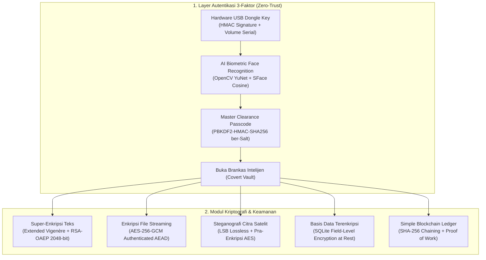

# AeroSat GroundStation (Sadap Crypto Intelligence Suite)

Aplikasi Desktop Kriptografi Ganda (*Dual-Mode Chameleon Application*) berbasis **Python 3.13** dan **PyQt6** yang mengusung prinsip **_Plausible Deniability_**.

Secara visual publik, aplikasi ini berfungsi normal sebagai **Konsol Observasi Citra Satelit & Telemetri Geospasial** bertema putih minimalis (*Aerospace White*). Namun saat diakses oleh operator terotorisasi melalui **Autentikasi Multi-Faktor Zero-Trust** (Hardware USB Dongle + Biometrik Wajah AI + Hash Passcode), aplikasi akan membuka instrumen spionase dan brankas kriptografi penuh.

---

## 🌟 Fitur Utama & Spesifikasi Keamanan



### 1. Zero-Trust 3-Factor Gatekeeper
* **Faktor 1 (Hardware Possession)**: Dongle USB fisik diverifikasi melalui pencocokan *Hardware Volume Serial Number* dan tanda tangan digital HMAC-SHA256 pada file `aerosat.sig`.
* **Faktor 2 (Biometric Factor)**: Face Recognition realtime menggunakan **OpenCV YuNet** (deteksi & alignment wajah 5-titik) dan **SFace** (representasi 128-D embedding & *cosine similarity*). Model berjalan **100% offline**.
* **Faktor 3 (Knowledge Factor)**: Verifikasi kredensial menggunakan **PBKDF2-HMAC-SHA256** dengan 200.000 iterasi dan *salt* 16-byte unik per-pengguna serta *constant-time comparison*.

### 2. Super-Enkripsi Teks (Vigenère + RSA-OAEP)
* **Kriptografi Klasik**: *Extended Vigenère Cipher* pada ruang modulo 256 (bebas kehilangan karakter pada spasi, tanda baca, emoji, angka, dan baris baru).
* **Kriptografi Modern**: *RSA-2048/4096-bit* dengan skema padding standar industri **RSA-OAEP (SHA-256 + MGF1)**.
* **Chunking Otomatis**: Mendukung enkripsi pesan teks dengan panjang tak terbatas.

### 3. Enkripsi Berkas (AES-256-GCM Streaming)
* Menggunakan mode **AEAD (Authenticated Encryption with Associated Data)** untuk menjamin kerahasiaan sekaligus integritas data (*16-byte authentication tag*).
* Pemrosesan *stream chunk* (buffer 64 KB) sehingga sangat ringan untuk file berukuran besar (PDF, video, citra satelit, ZIP).
* Menyimpan dan memulihkan nama dan ekstensi berkas asli secara otomatis.

### 4. Steganografi Citra Satelit (LSB)
* Menyisipkan muatan data rahasia ke dalam bit terendah (*Least Significant Bit*) kanal warna RGB citra *lossless* (PNG/BMP).
* Vektorisasi NumPy instan dengan *header biner 9-byte* `[Magic 'AERO' 4B] + [Flags 1B] + [Length 4B]`.
* Mendukung pra-enkripsi **AES-256-GCM** sebelum disisipkan ke piksel citra (*Crypto-Stego Hybrid*).
* Menghitung nilai distorsi visual **PSNR (Peak Signal-to-Noise Ratio)** secara otomatis (rata-rata > 60 dB, tidak kasat mata).

### 5. Basis Data Terenkripsi Lokal (Encryption at Rest)
* Menggunakan basis data SQLite (`data/vault.db`).
* Seluruh kolom sensitif (isi memo, nama berkas rahasia, preview steganografi, dan detail audit log) dienkripsi menggunakan AES-256-GCM sebelum ditulis ke disk.

### 6. Simple Blockchain untuk Integritas Aset
* Struktur data blok abadi dengan hashing **SHA-256** dan konsensus **Proof of Work (PoW)**.
* Notarisasi berkas intelijen: Menghitung sidik jari SHA-256 berkas dan menguncinya ke dalam blok blockchain.
* Fungsi audit rantai `is_chain_valid()`: Mendeteksi manipulasi data masa lalu secara instan.

---

## 🚀 Panduan Instalasi & Persiapan

### 1. Prasyarat Sistem
* **Python**: Versi 3.13 (atau 3.11+) pada Windows / Linux / macOS.
* **Webcam**: Kamera laptop atau eksternal (tersedia juga opsi verifikasi via foto).

### 2. Setup Virtual Environment & Dependensi
```bash
# Masuk ke direktori proyek
cd D:\Sadap-Crypto-App

# Aktifkan virtual environment
.\.venv\Scripts\Activate.ps1

# Instal seluruh dependensi
pip install -r requirements.txt
```

---

## 🎮 Panduan Menjalankan & Skenario Demonstrasi

### Menjalankan Aplikasi
```bash
python main.py
```

### Langkah Skenario Demo:

#### 1. Masuk ke Mode Publik (Cover Mode)
* Aplikasi akan terbuka dengan antarmuka **Konsol Observasi Satelit** bertema putih minimalis.
* Amati peta animasi satelit yang bergerak secara realtime di sebelah kiri, telemetri ketinggian dan kecepatan orbit, serta citra satelit di sebelah kanan.

#### 2. Memicu Gerbang Rahasia (*Secret Gatekeeper*)
* Klik tombol **"📡 Secure Uplink (Restricted)"** di sudut kanan bawah, atau tekan kombinasi *hotkey* rahasia:
  ```text
  Ctrl + Shift + S
  ```
* Jendela modal otorisasi 3-faktor akan muncul:
  1. **USB Dongle**: Sistem otomatis mendeteksi flashdisk USB (atau virtual dongle di `data/virtual_dongle/`).
  2. **Biometrik Wajah**: Klik **"Start Camera"** untuk pemindaian webcam langsung, atau gunakan tombol **"Verify via Photo..."** untuk verifikasi dari file foto.
  3. **Passcode**: Masukkan passcode master default:
     ```text
     AeroSat-Commander-2026!
     ```
* Klik **"🔓 Unlock Classified Vault"** untuk membuka brankas rahasia.

#### 3. Eksplorasi 5 Tab Brankas Kriptografi
1. **Tab 1: Super-Cipher Memo (Vigenère + RSA)**:
   - Ketik pesan rahasia di panel kiri, tentukan kunci Vigenère, lalu klik **"Execute Super-Encryption"**.
   - Salin token Base64 yang dihasilkan ke panel kanan, lalu klik **"Execute Super-Decryption"** untuk membuktikan pesan dapat dipulihkan secara presisi.
2. **Tab 2: File AES-256 Vault**:
   - Pilih berkas apa saja (misal file teks, PDF, atau gambar), masukkan passphrase, lalu klik **"Encrypt File"**. File akan terenkripsi menjadi berkas biner `.enc`.
   - Pilih berkas `.enc` tersebut, lalu klik **"Decrypt File"** untuk mengembalikan berkas asli.
3. **Tab 3: Satellite Stego Lab**:
   - Pilih citra satelit penutup (*cover image*), masukkan teks rahasia dan passphrase opsional, lalu klik **"Embed Secret Payload"**.
   - Pada panel kanan, pilih gambar stego yang dihasilkan lalu klik **"Extract Secret Payload"** untuk membaca pesan yang tersembunyi di balik piksel citra.
4. **Tab 4: Encrypted DB Vault**:
   - Buka tab ini untuk melihat tabel memo rahasia, arsip file, dan log audit.
   - Perhatikan bahwa jika file `data/vault.db` dibuka dengan aplikasi DB Browser luar tanpa passphrase, isinya terkunci dan tidak dapat dibaca.
5. **Tab 5: Blockchain Ledger**:
   - Lihat riwayat blok dan transaksi aset digital.
   - Klik **"🛡️ Audit Chain Integrity"** untuk memverifikasi keabsahan seluruh rantai hash SHA-256.
   - Klik **"📜 Notarize File..."** untuk mendaftarkan sidik jari dokumen rahasia ke dalam blok baru.

#### 4. Mengunci Kembali ke Mode Cover
* Klik tombol merah **"🔒 Lock & Return to Cover Mode"** di pojok kanan atas.
* Sesi rahasia akan ditutup, kredensial dibersihkan dari memori, dan aplikasi kembali menjadi stasiun satelit biasa.

---

## 🛠️ Alat Bantu Mandiri (CLI Tools)

1. **Inisialisasi USB Dongle Nyata (Flashdisk Fisik)**:
   ```bash
   python tools/setup_dongle.py
   ```
2. **Pendaftaran Wajah Operator Baru**:
   ```bash
   python tools/register_face.py
   ```

---

## 🧪 Menjalankan Automated Unit Tests

Seluruh modul dilengkapi pengujian unit otomatis komprehensif (52 test cases):

```bash
# Menjalankan seluruh 52 test suite proyek
python -m unittest discover tests

# Atau menjalankan pengujian skenario misi End-to-End
python -m unittest tests/test_end_to_end.py
```

---

## 📂 Struktur Direktori Proyek

Rincian arsitektur berkas dan pemisahan tanggung jawab (*separation of concerns*) dapat dilihat pada dokumen:
* 📄 **[struktur.md](struktur.md)** — Struktur direktori dan pohon file.
* 📄 **[context.md](context.md)** — Konteks dan filosofi desain Plausible Deniability.
* 📄 **[planning.md](planning.md)** — Roadmap dan rincian langkah kerja Fase 1 - 9.
