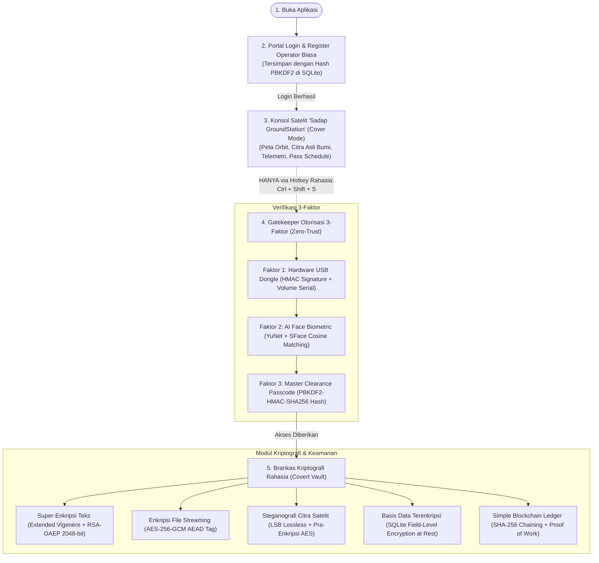

# Sadap GroundStation (Sadap Crypto Intelligence Suite)

Aplikasi Desktop Kriptografi Ganda (*Dual-Mode Chameleon Application*) berbasis **Python 3.13** dan **PyQt6** yang mengusung prinsip **_Plausible Deniability_** (Penyangkalan yang Masuk Akal).

Secara visual dan operasional publik, aplikasi ini adalah **Konsol Observasi Citra Satelit Bumi & Telemetri Geospasial** yang sah, padat, dan berfungsi penuh. Aplikasi dilengkapi portal login/register operator normal, penampil citra satelit asli bumi beresolusi tinggi, pelacak orbit satelit nyata, jadwal lintasan (*AOS/LOS pass*), dan terminal log telemetri langsung.

**Tidak ada tombol rahasia apa pun di layar.** Akses ke **Brankas Kriptografi Hitam (*BlackOps Vault*)** hanya dapat dibuka melalui kombinasi tombol rahasia (**`Ctrl + Shift + S`**) yang dilindungi oleh **Autentikasi Multi-Faktor Zero-Trust** (Hardware USB Dongle + Biometrik Wajah AI + Hash Passcode).

---

## 🌟 Arsitektur & Alur Operasional Sistem



---

## 🛰️ Fitur Halaman Cover (Padat & Fungsional)

Halaman Cover dirancang sangat meyakinkan dan fungsional:
1. **Citra Satelit Asli Bumi Resolusi Tinggi**:
   - Memuat foto satelit riil dari server observasi bumi (ESRI World Imagery / Landsat / Sentinel-2).
   - Preset lokasi nyata: **Jakarta Metropolitan**, **IKN Nusantara**, **Selat Sunda & Gunung Krakatau**, **Tokyo Bay**, dan **Gunung Fuji**.
   - Filter multi-spektral interaktif: *RGB True Color*, *Thermal Infrared Radiance*, *NDVI Vegetation Index*, dan *False Color Urban*.
2. **Pelacak Satelit Nyata & Peta Orbit**:
   - Pelacakan satelit riil: **SADAP-SV09**, **ISS (Stasiun Luar Angkasa Internasional)**, **Landsat-9**, **Sentinel-2A**, dan **NOAA-20**.
   - Peta radar animasi koordinat lintang dan bujur realtime.
3. **Panel Sensor Telemetri & Daya**:
   - Menampilkan *Orbit Altitude*, *Ground Velocity*, *Downlink Frequency*, *Antenna Azimuth*, *Signal SNR*, daya panel surya (*Solar Array Watts*), dan indikator baterai satelit.
4. **Jadwal Lintasan Orbit (*AOS/LOS Pass Prediction Schedule*)**:
   - Tabel prediksi waktu melintas satelit di atas stasiun bumi (*Acquisition of Signal*, *Max Elevation*, *Duration*).
5. **Terminal Log Telemetri Real-Time (*Live Stream*)**:
   - Menampilkan streaming bingkai data telemetri yang ter-dekode secara langsung setiap beberapa detik.
6. **Sesi Operator**:
   - Menampilkan identitas operator yang sedang bertugas (*Callsign* & *Mission Role*) dan tombol *Sign Out*.

---

## 🔐 Spesifikasi Modul Kriptografi & Keamanan

* **Autentikasi Operator Biasa**: Disimpan dalam tabel `station_operators` dengan hash **PBKDF2-HMAC-SHA256** dan *salt* unik 16-byte.
* **USB Hardware Dongle**: Memverifikasi *Volume Serial Number* fisik perangkat keras flashdisk dan *HMAC-SHA256 signature token* pada file `aerosat.sig`.
* **Biometrik Wajah AI**: Menggunakan model Deep Learning mutakhir **OpenCV 5 YuNet** (deteksi & landmark 5-titik) dan **SFace** (128-D embedding & *cosine similarity*). Berjalan **100% offline** tanpa ketergantungan internet.
* **Super-Enkripsi Teks**: Kombinasi kriptografi klasik **Extended Vigenère Cipher** (modulo 256) dan modern **RSA-OAEP 2048-bit** dengan mekanisme pemecahan blok otomatis (*chunking*).
* **Enkripsi File AES**: Menggunakan **AES-256-GCM (Authenticated Encryption with Associated Data)** dengan streaming buffer 64 KB, proteksi pemalsuan tag, dan pemulihan nama berkas asli.
* **Steganografi Citra LSB**: Vektorisasi NumPy instan untuk menyisipkan pesan/berkas rahasia ke bit LSB kanal warna RGB citra satelit lossless (PNG/BMP) dengan metrik PSNR > 60 dB (tak kasat mata).
* **Basis Data Terenkripsi**: SQLite `data/vault.db` dengan *field-level encryption* otomatis menggunakan AES-256-GCM.
* **Simple Blockchain**: Rantai blok dengan hashing SHA-256, konsensus *Proof of Work (PoW)*, notarisasi sidik jari file, dan deteksi pemalsuan data seketika (`is_chain_valid`).

---

## 🚀 Panduan Menjalankan Aplikasi

### 1. Menjalankan Aplikasi
```powershell
cd D:\Sadap-Crypto-App
.\.venv\Scripts\python.exe main.py
```

### 2. Kredensial Akses Bawaan (Default Demo Credentials)

| Layanan | Username / Callsign | Password / Passcode | Keterangan |
| :--- | :--- | :--- | :--- |
| **Portal Operator Biasa** | `operator` | `operator123` | Masuk ke Cover Stasiun Satelit biasa (atau daftar akun baru) |
| **Passcode Master Vault** | `COMMANDER-01` | `Sadap-Commander-2026!` | Digunakan pada dialog otorisasi 3-faktor gerbang rahasia |

---

## 🎮 Skenario Demonstrasi Lengkap

1. **Langkah 1: Masuk Melalui Portal Operator**
   - Jalankan `main.py`. Jendela **Operator Sign In** akan muncul.
   - Masukkan username `operator` dan password `operator123` (atau klik tab **"Register New Operator"** untuk mendaftarkan akun baru).
   - Klik **"Sign In to Ground Station"**.
2. **Langkah 2: Menjelajahi Cover Mode Satelit**
   - Konsol stasiun satelit **Sadap GroundStation** akan terbuka.
   - Ganti pilihan lokasi citra satelit (misal: *IKN Nusantara*, *Jakarta*, *Mount Krakatau*), ganti filter citra (*Thermal IR*, *NDVI*), dan ganti target satelit (*ISS*, *Landsat-9*).
   - Perhatikan bahwa **tidak ada tombol rahasia apa pun** di antarmuka ini.
3. **Langkah 3: Memicu Gerbang Rahasia (The Secret Trigger)**
   - Tekan kombinasi tombol rahasia pada keyboard:
     ```text
     Ctrl + Shift + S
     ```
   - Modal otorisasi **Zero-Trust 3-Factor** akan muncul:
     - **Faktor 1 (USB)**: Otomatis mendeteksi USB dongle (tersedia virtual dongle bawaan di `data/virtual_dongle/`).
     - **Faktor 2 (Face)**: Nyalakan webcam untuk scan wajah, atau pilih verifikasi foto/simulasi.
     - **Faktor 3 (Passcode)**: Masukkan passcode master `Sadap-Commander-2026!`.
   - Klik **"🔓 Unlock Classified Vault"**.
4. **Langkah 4: Operasi Brankas Kriptografi**
   - Jendela stasiun satelit disembunyikan dan jendela **Sadap Classified Vault** akan terbuka.
   - Gunakan 5 tab instrumen kripto:
     - 📜 **Super-Cipher**: Enkripsi dan dekripsi pesan rahasia ganda (Vigenère + RSA).
     - 📁 **File AES-256**: Enkripsi berkas apa saja menjadi format biner `.enc` dan dekripsi kembali.
     - 🛰️ **Stego Lab**: Sisipkan pesan rahasia ke dalam citra satelit dan ekstrak kembali.
     - 🗄️ **DB Vault**: Akses tabel SQLite yang terenkripsi penuh di disk.
     - ⛓️ **Blockchain**: Lakukan audit integritas rantai blok dan daftarkan sidik jari berkas.
5. **Langkah 5: Mengunci Kembali ke Mode Cover**
   - Klik tombol merah **"🔒 Lock & Return to Cover Mode"** di pojok kanan atas.
   - Brankas rahasia langsung tertutup dan jendela stasiun satelit muncul kembali tanpa jejak.

---

## 🧪 Pengujian Unit & Integrasi Otomatis

Seluruh modul telah diuji menggunakan **53 automated unit tests** dengan hasil kelulusan **100%**:

```powershell
# Menjalankan seluruh 53 unit test proyek
.\.venv\Scripts\python.exe -m unittest discover tests

# Menjalankan pengujian skenario misi End-to-End
.\.venv\Scripts\python.exe -m unittest tests/test_end_to_end.py
```
