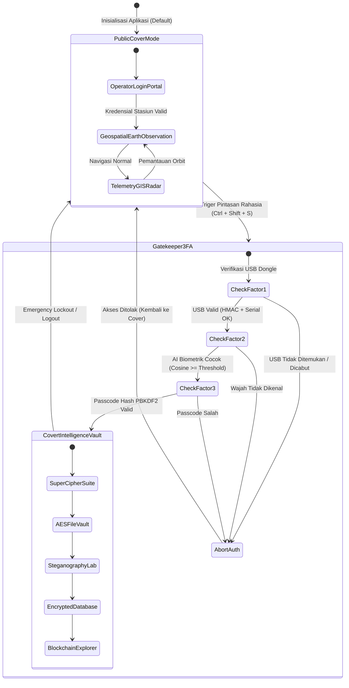
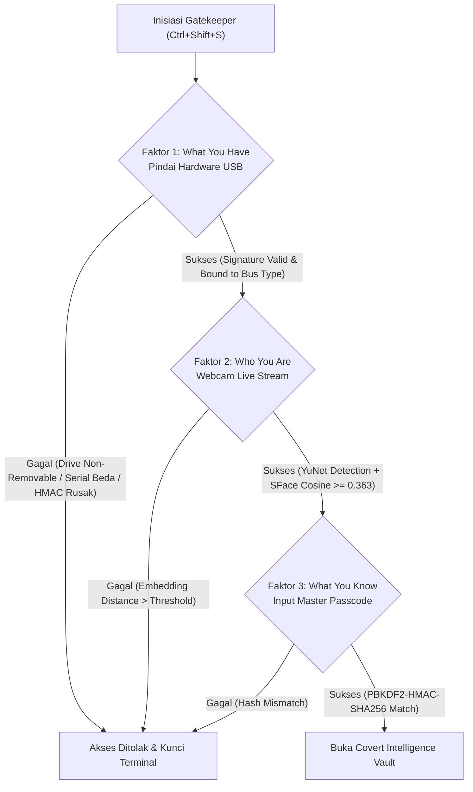
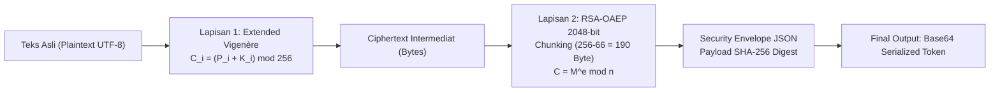
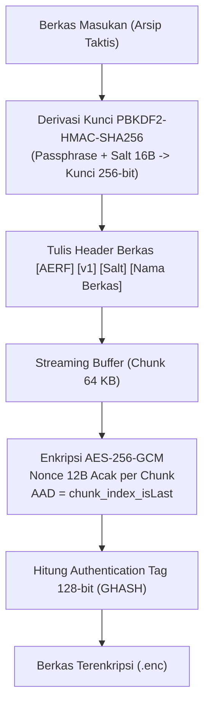
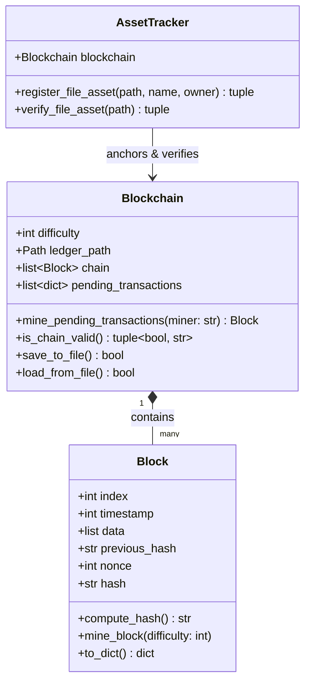
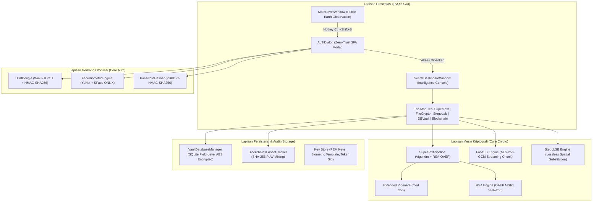
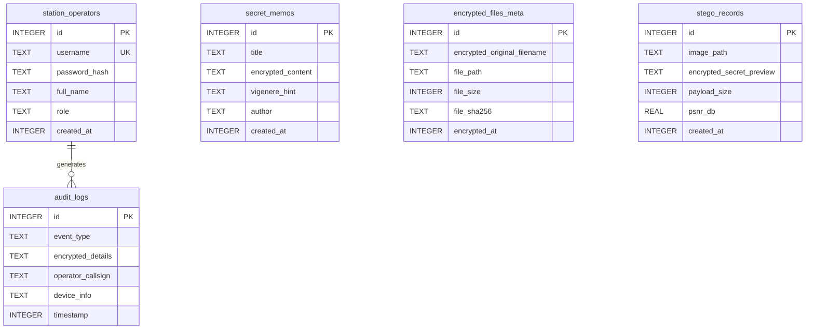
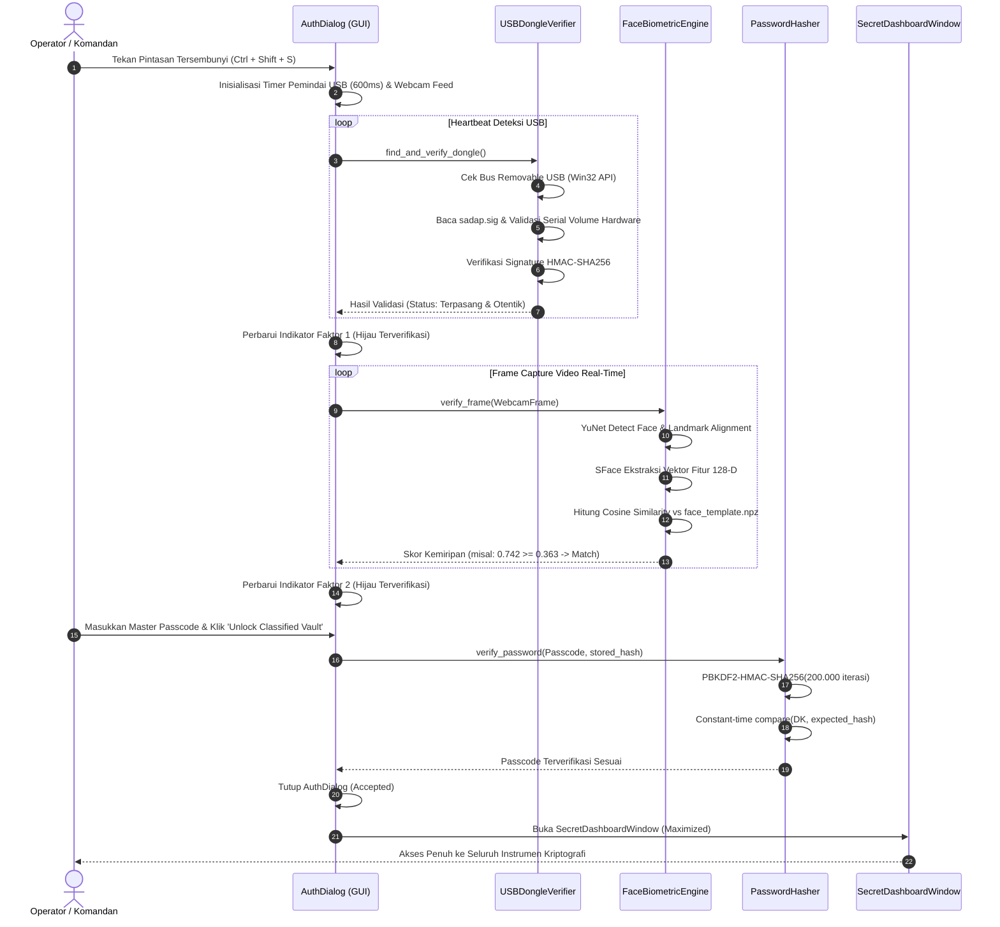
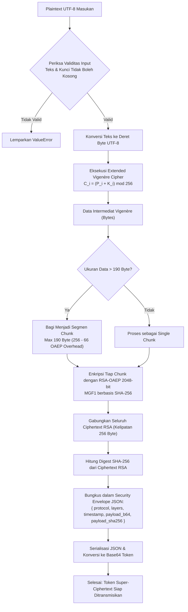

# LAPORAN TUGAS AKHIR KRIPTOGRAFI

---

## JUDUL LAPORAN:
**"RANCANG BANGUN AEROSAT GROUNDSTATION: IMPLEMENTASI CHAMELEON APPLICATION DENGAN SISTEM KEAMANAN BERLAPIS BERBASIS 3-FACTOR AUTHENTICATION, SUPER ENKRIPSI VIGENÈRE-RSA, STEGANOGRAFI CITRA SATELIT, DAN PROOF-OF-WORK BLOCKCHAIN"**

---

### ABSTRAK

Dalam era transmisi telemetri kedirgantaraan dan perang asimetris digital, perlindungan terhadap integritas dan kerahasiaan data intelijen menjadi salah satu prioritas keamanan nasional yang paling krusial. Pendekatan kriptografi konvensional yang semata-mata mengandalkan penyandian data sering kali gagal mengatasi ancaman pemaksaan (*rubber-hose cryptanalysis*) atau analisis forensik fisik, karena keberadaan berkas terenkripsi atau antarmuka aplikasi kriptografi itu sendiri memicu kecurigaan pihak lawan. Proyek tugas akhir ini merancang dan membangun sistem perangkat lunak bernama **AeroSat GroundStation**, sebuah aplikasi berkamuflase (*Chameleon Application*) yang menerapkan prinsip *Plausible Deniability* melalui *Dual-Mode Architecture*.

Aplikasi ini memiliki dua identitas fungsional: mode overt publik yang berfungsi penuh sebagai konsol stasiun bumi penerima citra satelit observasi bumi dan telemetri orbit (dilengkapi visualisasi radar GIS dan peta hibrida resolusi tinggi), serta mode covert rahasia (*The Vault*) yang hanya dapat diakses melalui mekanisme *Zero-Trust 3-Factor Authentication* (3FA). Tiga lapis autentikasi tersebut memadukan *What You Have* (verifikasi serial perangkat keras dan signature HMAC-SHA256 pada media penyimpanan USB fisik), *Who You Are* (pemindaian biometrik wajah waktu-nyata berbasis deep learning YuNet dan SFace dengan metrik kemiripan kosinus), dan *What You Know* (validasi *Master Passcode* melalui PBKDF2-HMAC-SHA256 dengan *cryptographic salt* per-pengguna dan pembandingan waktu-konstan).

Di dalam bilik rahasia intelijen, sistem mengintegrasikan lima subsistem kriptografi tingkat lanjut: (1) Super Enkripsi Hibrida pesan teks menggabungkan *Extended Vigenère Cipher* mod 256 dan RSA-OAEP 2048-bit; (2) Enkripsi berkas dokumen taktis menggunakan AES-256-GCM berbasis *streaming chunk* 64 KB yang menjamin kerahasiaan (*confidentiality*) dan keabsahan autentikasi (*integrity*) via tag 128-bit; (3) Steganografi domain spasial *Least Significant Bit* (LSB) pada citra satelit tanpa distorsi kasat mata (*imperceptible*, PSNR > 65 dB); (4) Basis data relasional SQLite terlindungi *field-level encryption at rest*; serta (5) Buku besar terdistribusi privat *Proof-of-Work* (PoW) Blockchain untuk notarisasi dan audit forensik integritas aset intelijen. Pengujian komprehensif terhadap 53 skenario unit dan integrasi membuktikan bahwa seluruh modul bekerja secara deterministik, resisten terhadap manipulasi data (*tampering*), dan sepenuhnya memenuhi 7 kriteria keunggulan tugas akhir kriptografi modern.

**Kata Kunci:** *Chameleon Application, Plausible Deniability, 3-Factor Authentication, Super Enkripsi, Extended Vigenère, RSA-OAEP, AES-256-GCM, Steganografi LSB, Proof of Work Blockchain, AeroSat GroundStation.*

---

## BAB I: PENDAHULUAN

### 1.1 Latar Belakang

Perkembangan teknologi observasi bumi dan satelit penginderaan jauh (*remote sensing*) telah menjadi tulang punggung dalam berbagai sektor strategis, mulai dari pemantauan iklim global, navigasi maritim, hingga pengawasan perbatasan pertahanan militer. Jalur komunikasi antara wahana antariksa orbit rendah (*Low Earth Orbit* - LEO) dan stasiun pengendali bumi (*Ground Station*) melibatkan pertukaran ribuan parameter telemetri, komando manuver orbit, serta transfer citra bumi beresolusi tinggi. Keterbukaan spektrum frekuensi radio (seperti pita frekuensi S-Band dan X-Band) menjadikan transmisi data satelit sangat rentan terhadap intersepsi, penyadapan (*eavesdropping*), pemalsuan perintah (*command injection*), dan serangan *man-in-the-middle* (MitM).

Dalam disiplin keamanan informasi, kriptografi secara historis diandalkan sebagai mekanisme pertahanan utama melalui transformasi matematis teks biasa (*plaintext*) menjadi teks tersandi (*ciphertext*). Standar modern seperti *Advanced Encryption Standard* (AES) dan *Rivest-Shamir-Adleman* (RSA) secara teoritis menawarkan ketahanan komputasi yang kokoh terhadap serangan *brute force*. Akan tetapi, dalam skenario dunia nyata dan operasi spionase siber, keamanan kriptografis murni menghadapi kelemahan mendasar: **keberadaan data terenkripsi itu sendiri merupakan sinyal mencurigakan**.

Ancaman ini termanifestasi dalam apa yang dikenal dalam literatur keamanan sebagai kriptanalisis selang karet (*rubber-hose cryptanalysis*), interogasi koersif, atau penyitaan perangkat secara fisik oleh otoritas hukum maupun musuh. Ketika sebuah laptop atau terminal operasional disita dan ditemukan perangkat lunak bernama *"Military Encryptor"* atau dokumen berkas biner acak dengan entropi tinggi, pihak pemeriksa akan langsung menyimpulkan bahwa terdapat rahasia yang disembunyikan. Dalam kondisi tersebut, operator dapat dipaksa secara hukum atau fisik untuk menyerahkan kunci dekripsi.

Untuk mengatasi paradoks ini, dikembangkanlah konsep **_Plausible Deniability_** (Penyangkalan yang Masuk Akal) yang diwujudkan dalam bentuk **_Chameleon Application_** (Aplikasi Berkamuflase). Paradigma ini berpijak pada prinsip bahwa:
$$\text{"Keamanan tertinggi tercapai bukan saat musuh gagal memecahkan enkripsi, melainkan saat musuh bahkan tidak menyadari bahwa enkripsi tersebut sedang digunakan."}$$

Aplikasi berkamuflase menampilkan antarmuka, alur kerja, dan fungsionalitas publik yang sepenuhnya sah, berguna, dan tidak membangkitkan kecurigaan—dalam hal ini sebagai konsol stasiun bumi penerima telemetri cuaca dan peta geospasial observasi bumi (*AeroSat GroundStation*). Seluruh instrumen kriptografi militer tingkat tinggi disembunyikan di balik dinding kamuflase tersebut, dan hanya dapat dipanggil menggunakan kombinasi pintasan tersembunyi yang divalidasi oleh gerbang otentikasi multi-faktor tanpa celah toleransi (*Zero-Trust Multi-Factor Authentication*).

### 1.2 Rumusan Masalah

Berdasarkan latar belakang tersebut, perancangan sistem keamanan berlapis pada stasiun pengendali satelit ini menghadapi beberapa permasalahan riset dan teknis yang dirumuskan sebagai berikut:
1. **Bagaimana merancang arsitektur aplikasi mode ganda (*Dual-Mode Architecture*) berbasis PyQt6** yang mampu mengisolasi total fungsi kamuflase publik (*Cover Story*) dari ruang kerja intelijen rahasia (*Covert Vault*), tanpa meninggalkan petunjuk visual atau kebocoran memori pada sistem operasi host?
2. **Bagaimana mengimplementasikan sistem gerbang otorisasi *Zero-Trust 3-Factor Authentication* (3FA)** yang memverifikasi kepemilikan token fisik USB (*Hardware Token Signature*), identitas biometrik wajah waktu-nyata berbasis pemodelan *deep learning* (YuNet dan SFace), serta faktor pengetahuan (*Master Passcode Hash*) dengan perlindungan terhadap serangan kamus, *rainbow table*, dan *timing attack*?
3. **Bagaimana membangun *pipeline* Super Enkripsi hibrida** yang memadukan kriptografi klasik *Extended Vigenère Cipher* (modulo 256 dengan dukungan karakter ASCII dan byte penuh) dan kriptografi asimetris modern RSA-OAEP 2048-bit dengan manajemen *chunk streaming* untuk menangani data berukuran sembarang?
4. **Bagaimana mengamankan dokumen berkas berukuran besar** menggunakan algoritma simetris AES-256-GCM dengan jaminan integritas *Authenticated Encryption with Associated Data* (AEAD) dan skema *chunk buffer* adaptif?
5. **Bagaimana mengintegrasikan teknik steganografi citra satelit *Least Significant Bit* (LSB)** dengan penyisipan metadata biner terstruktur, verifikasi *magic bytes*, opsi pra-enkripsi AES, serta menjamin nilai *Peak Signal-to-Noise Ratio* (PSNR) tetap berada di atas batas persepsi kasat mata manusia?
6. **Bagaimana merancang arsitektur basis data relasional SQLite lokal** yang menerapkan enkripsi transparan tingkat kolom (*Field-Level Encryption at Rest*) dengan pengelolaan kunci dinamis di memori volatil RAM?
7. **Bagaimana membangun buku besar *Proof-of-Work* (PoW) Blockchain privat** untuk memelihara riwayat audit dan mendeteksi segala bentuk upaya manipulasi atau pemalsuan data (*tamper detection*) terhadap aset digital intelijen secara matematis?

### 1.3 Batasan Masalah

Guna menjaga fokus perancangan, penulisan, dan kedalaman analisis, penelitian tugas akhir ini dibatasi pada batasan-batasan teknis berikut:
1. **Lingkungan Eksekusi & Bahasa Pemrograman**: Aplikasi dikembangkan pada bahasa pemrograman Python versi 3.11/3.13 dan framework antarmuka grafis PyQt6 pada sistem operasi Windows 64-bit.
2. **Karakteristik Citra Steganografi**: Format citra pembawa (*cover image*) dibatasi pada format citra kompresi nirrugi (*lossless*), khususnya PNG (*Portable Network Graphics*) dan BMP (*Bitmap*), pada model warna RGB 24-bit (8-bit per kanal warna) guna mencegah degradasi bit akibat kompresi berbayang (*lossy artifacts*).
3. **Lingkup Ledger Blockchain**: Implementasi *Blockchain* difokuskan sebagai buku besar audit privat internal (*internal notarization ledger*) dengan konsensus *Proof of Work* lokal (tingkat kesulitan heksadesimal dengan awalan nol tetap), tanpa melibatkan pertukaran token moneter atau mekanisme *peer-to-peer gossip protocol* skala luas.
4. **Perangkat Keras Biometrik & Token**: Deteksi biometrik wajah memanfaatkan perangkat kamera web (*webcam*) standar beresolusi minimal 720p, dan token fisik menggunakan media penyimpanan lepas-pasang USB (*removable flash drive*) dengan sistem berkas FAT32/NTFS standar.

### 1.4 Tujuan Proyek

Tujuan dari proyek tugas akhir ini adalah merancang, merekayasa, dan memverifikasi sistem keamanan informasi terpadu yang memenuhi **tujuh kriteria keunggulan tugas akhir kriptografi**:
1. Merealisasikan arsitektur *Plausible Deniability* yang menyamarkan fungsi intelijen menjadi stasiun bumi telemetri satelit observasi ilmiah.
2. Mengembangkan mekanisme gerbang keamanan *Zero-Trust 3FA* dengan validasi perangkat keras fisik, biometrik AI, dan fungsi derivasi kunci berkekuatan tinggi.
3. Menggabungkan kriptografi klasik dan asimetris modern ke dalam skema *Super Enkripsi* pesan teks (Extended Vigenère + RSA-OAEP).
4. Menerapkan enkripsi berkas dokumen taktis berbasis *Authenticated Encryption* AES-256-GCM dengan mekanisme *chunk streaming*.
5. Menyembunyikan muatan rahasia ke dalam citra satelit menggunakan steganografi LSB berkecepatan tinggi dengan evaluasi imperseptibilitas visual (PSNR).
6. Melindungi kerahasiaan data riwayat operasional pada disk lokal melalui *Field-Level Encryption at Rest* pada SQLite.
7. Membangun mekanisme audit forensik dan jaminan kekekalan data (*immutability*) menggunakan rantai blok *Proof-of-Work* Blockchain.

---

## BAB II: LANDASAN TEORI & FORMULASI MATEMATIS

### 2.1 Konsep Plausible Deniability & Arsitektur Dual-Mode UI

Prinsip *Plausible Deniability* dalam kriptografi modern berakar pada doktrin bahwa seorang pengguna harus memiliki kemampuan rasional dan dapat dibuktikan untuk menyangkal bahwa suatu muatan informasi terenkripsi sedang disimpan atau diproses di dalam sistemnya. Dalam rekayasa perangkat lunak, paradigma ini diimplementasikan melalui **Chameleon Application Architecture** (Arsitektur Aplikasi Bunglon), di mana struktur program memiliki dua status eksekusi terisolasi:



Pada *Public Cover Mode*, antarmuka menyajikan lingkungan kerja stasiun bumi penerima orbit: pemilihan wahana satelit (misal: SADAP-SV09, ISS Alpha, Landsat-9, Sentinel-2A), komputasi lintasan sub-satelit (*orbit ground track*), pemantauan deviasi frekuensi Doppler, daya susunan sel surya, serta penampil peta citra satelit hibrida resolusi tinggi. Tidak ada elemen antarmuka grafis (seperti tombol, menu dropdown, atau ikon) yang mengindikasikan adanya fungsi kriptografi tersembunyi.

Peralihan status (*state transition*) menuju *Covert Intelligence Vault* dikontrol secara eksklusif oleh *interceptor* pintasan papan ketik global (*key sequence hook*) `Ctrl + Shift + S`. Interseptor ini memicu modal dialog otorisasi *Gatekeeper* tanpa mengubah perilaku visual jendela publik jika autentikasi dibatalkan.

---

### 2.2 Autentikasi 3-Faktor Zero-Trust

Filosofi *Zero-Trust* mensyaratkan bahwa sistem tidak memberikan kepercayaan secara implisit kepada pengguna mana pun, baik yang berada di dalam perimeter jaringan maupun yang memegang kendali fisik atas komputer. Otorisasi menuju mode intelijen menuntut pemenuhan simultan dari tiga faktor autentikasi independen:



#### 2.2.1 Faktor 1: Hardware USB Token Signature
Faktor pertama memverifikasi kepemilikan fisik media penyimpanan USB eksternal yang sah. Sistem melakukan validasi ganda pada aras sistem operasi:
1. **Inspeksi Bus Fisik & Tipe Drive**: Pada Windows API, sistem memanggil fungsi `kernel32.GetDriveTypeW`. Tipe penyimpanan harus bernilai `DRIVE_REMOVABLE` (kode `0x02`). Untuk media penyimpanan eksternal berkapasitas besar yang dilaporkan sebagai fixed disk (`0x03`), sistem melakukan panggilan kendali I/O tingkat rendah:
   $$\text{DeviceIoControl}(\text{hDevice}, \text{IOCTL\_STORAGE\_QUERY\_PROPERTY}, \dots)$$
   dan memverifikasi bahwa field `BusType` pada struktur `STORAGE_DEVICE_DESCRIPTOR` bernilai `BusTypeUsb` (`0x07`). Partisi sistem internal (misalnya `C:\`) secara mutlak ditolak.
2. **Pencocokan Serial Volume Perangkat Keras**: Mengambil nomor seri biner volume disk melalui `kernel32.GetVolumeInformationW`:
   $$S_{vol} = \text{High16}(V) \parallel \text{Low16}(V)$$
3. **Verifikasi Tanda Tangan Kriptografis HMAC-SHA256**: Berkas token `sadap.sig` pada direktori akar USB memuat payload JSON kanonikal:
   $$M_{token} = \text{"magic"} \parallel \text{"token\_id"} \parallel \text{"device\_serial"} \parallel \text{"operator\_callsign"} \parallel \text{"issued\_timestamp"}$$
   Tanda tangan dihitung menggunakan kunci master rahasia sistem $K_{master}$:
   $$\text{HMAC-SHA256}(K_{master}, M_{token}) = H\Big((K_{master} \oplus opad) \parallel H\big((K_{master} \oplus ipad) \parallel M_{token}\big)\Big)$$
   di mana $ipad = \text{0x36}^{64}$ dan $opad = \text{0x5C}^{64}$. Pembandingan tanda tangan aktual dan tanda tangan tersimpan wajib menggunakan fungsi pembanding waktu-konstan (*constant-time comparison*) untuk meniadakan celah *timing side-channel attack*.

#### 2.2.2 Faktor 2: Deteksi & Ekstraksi Biometrik Wajah AI Real-Time
Faktor kedua membuktikan kehadiran biologis operator terdaftar (*Who You Are*) menggunakan dua model jaringan saraf tiruan terkuantisasi:
1. **Deteksi dan Penjajaran Wajah (YuNet)**: Model konvolusional berbasis *feature map* yang mendeteksi kotak pembatas wajah (*bounding box*) dan lima titik marka anatomis (*landmarks*): kedua pupil mata, ujung hidung, serta kedua sudut bibir.
2. **Ekstraksi Fitur 128-Dimensi (SFace)**: Citra wajah yang telah dipotong dan disejajarkan (*aligned face*) ditransformasikan melalui model SFace menjadi vektor fitur bernilai riil 128-dimensi:
   $$\mathbf{u} = [u_1, u_2, \dots, u_{128}] \in \mathbb{R}^{128}$$
3. **Formulasi Metrik Kemiripan Kosinus (*Cosine Similarity*)**:
   Kemiripan antara vektor embedding wajah waktu-nyata ($\mathbf{u}$) dan vektor template operator terdaftar ($\mathbf{v}$) dihitung berdasarkan dot product yang dinormalisasi:
   $$S_C(\mathbf{u}, \mathbf{v}) = \frac{\mathbf{u} \cdot \mathbf{v}}{\|\mathbf{u}\|_2 \|\mathbf{v}\|_2} = \frac{\sum_{i=1}^{128} u_i v_i}{\sqrt{\sum_{i=1}^{128} u_i^2} \cdot \sqrt{\sum_{i=1}^{128} v_i^2}}$$
   Keputusan verifikasi biometrik ditentukan oleh fungsi ambang batas (*threshold decision function*):
   $$\text{Status} = \begin{cases} \text{Diterima (Verified)}, & \text{jika } S_C(\mathbf{u}, \mathbf{v}) \ge \tau_C \\ \text{Ditolak (Rejected)}, & \text{jika } S_C(\mathbf{u}, \mathbf{v}) < \tau_C \end{cases}$$
   Berdasarkan benchmark empiris model SFace, nilai ambang batas ditetapkan pada $\tau_C = 0.363$ (dan ambang batas jarak Euclidean L2 $\tau_{L2} \le 1.128$).

#### 2.2.3 Faktor 3: Fungsi Derivasi Kunci Kredensial (PBKDF2-HMAC-SHA256)
Faktor ketiga menguji pengetahuan rahasia operator (*What You Know*) menggunakan skema peregangan kunci (*key stretching*) berbasis standar NIST SP 800-132. Formulasi matematika PBKDF2 didefinisikan sebagai:
$$DK = \text{PBKDF2}(PRF, \text{Password}, \text{Salt}, c, dkLen)$$
di mana $PRF$ adalah $\text{HMAC-SHA256}$, garam (*cryptographic salt*) berupa deret acak kriptografis 16-byte ($S \in \{0,1\}^{128}$), jumlah iterasi $c = 200.000$, dan panjang kunci keluaran $dkLen = 32 \text{ byte}$ (256 bit).

Blok kunci derivasi dihitung melalui relasi rekursif:
$$DK = T_1 \parallel T_2 \parallel \dots \parallel T_l$$
$$T_i = U_1 \oplus U_2 \oplus \dots \oplus U_c$$
$$U_1 = \text{PRF}(\text{Password}, \text{Salt} \parallel \text{INT\_32\_BE}(i))$$
$$U_j = \text{PRF}(\text{Password}, U_{j-1}) \quad \text{untuk } j = 2, 3, \dots, c$$
Beban komputasi $200.000$ siklus hashing per otentikasi secara efektif menggagalkan serangan akselerasi perangkat keras GPU/FPGA dalam merekonstruksi kata sandi melalui serangan kamus (*dictionary attack*) maupun *rainbow table*.

---

### 2.3 Super Enkripsi Hibrida (Extended Vigenère + RSA-OAEP)

Super Enkripsi adalah metodologi penggabungan dua atau lebih algoritma penyandian yang memiliki sifat matematis berbeda untuk membentuk satu saluran kriptografi yang kokoh. Dalam sistem ini, teks intelijen disandikan melalui dua lapisan berurutan:



#### 2.3.1 Lapisan 1: Extended Vigenère Cipher (Modulo 256)
Berbeda dengan Vigenère alfabet klasik yang beroperasi pada gelang modulo 26 ($\mathbb{Z}_{26}$) dan rentan terhadap distorsi spasi serta tanda baca, *Extended Vigenère Cipher* beroperasi penuh pada domain byte modulo 256 ($\mathbb{Z}_{256}$). Hal ini menjamin transmisi karakter multinasional UTF-8, baris baru (`\n`), angka, dan simbol biner berjalan tanpa kehilangan data (*100% loss-free*).

Diberikan deret byte pesan terbuka $P = (p_0, p_1, \dots, p_{n-1})$ di mana $p_i \in [0, 255]$ dan kunci periodik $K = (k_0, k_1, \dots, k_{m-1})$ di mana $k_j \in [0, 255]$.
- **Transformasi Enkripsi**:
  $$c_i = (p_i + k_{i \pmod m}) \pmod{256}$$
- **Transformasi Dekripsi**:
  $$p_i = (c_i - k_{i \pmod m} + 256) \pmod{256}$$

#### 2.3.2 Lapisan 2: Kriptografi Asimetris RSA & Skema Padding OAEP
Data intermediat $C_{vig}$ dienkripsi menggunakan kunci publik RSA penerima.
1. **Pembangkitan Parameter RSA**:
   - Dua bilangan prima acak besar yang dirahasiakan: $p$ dan $q$, sedemikian rupa sehingga ukuran modulus $n = p \cdot q$ adalah 2048 bit.
   - Fungsi Totient Euler: $\phi(n) = (p - 1)(q - 1)$.
   - Eksponen publik standar: $e = 65537 = 2^{16} + 1$, di mana $\gcd(e, \phi(n)) = 1$.
   - Eksponen privat dihitung melalui invers perkalian modular:
     $$d \equiv e^{-1} \pmod{\phi(n)} \iff e \cdot d \equiv 1 \pmod{\phi(n)}$$
2. **Optimal Asymmetric Encryption Padding (OAEP)**:
   Untuk meniadakan sifat multiplikatif RSA klasik ($E(m_1) \cdot E(m_2) \equiv E(m_1 \cdot m_2) \pmod n$) yang rentan terhadap serangan teks-terpilih adaptif (*Chosen-Ciphertext Attack* - CCA2), diterapkan skema OAEP berbasis fungsi generator topeng MGF1 dan fungsi hash SHA-256.

   Struktur diagram blok OAEP didefinisikan sebagai berikut:
   $$\text{DB} = \text{Hash}(L) \parallel PS \parallel \text{0x01} \parallel M$$
   di mana $L$ adalah label opsional, $PS$ adalah deret padding nol, dan $M$ adalah pesan intermediat.
   $$\text{seed} \overset{\$}{\leftarrow} \{0, 1\}^{hLen}$$
   $$\text{dbMask} = \text{MGF1}(\text{seed}, k - hLen - 1)$$
   $$\text{maskedDB} = \text{DB} \oplus \text{dbMask}$$
   $$\text{seedMask} = \text{MGF1}(\text{maskedDB}, hLen)$$
   $$\text{maskedSeed} = \text{seed} \oplus \text{seedMask}$$
   $$\text{EM} = \text{0x00} \parallel \text{maskedSeed} \parallel \text{maskedDB}$$
   di mana $hLen = 32 \text{ byte}$ untuk SHA-256. Total overhead padding adalah $2 \cdot hLen + 2 = 66 \text{ byte}$. Dengan demikian, kapasitas muatan maksimum tiap blok untuk kunci 2048 bit (256 byte) adalah:
   $$\text{MaxChunkSize} = 256 - 66 = 190 \text{ byte}$$
3. **Formulasi Enkripsi & Dekripsi RSA**:
   - Mengubah blok padded $\text{EM}$ menjadi representasi integer modular:
     $$C_{rsa} \equiv (\text{EM})^e \pmod n$$
   - Proses dekripsi menggunakan kunci privat $d$:
     $$\text{EM} \equiv (C_{rsa})^d \pmod n$$
     dilanjutkan dengan pembalikan topeng OAEP untuk mengekstrak byte pesan asli. Untuk data yang melebihi 190 byte, algoritma mengeksekusi segmentasi *chunking* otomatis.

---

### 2.4 Enkripsi Berkas Dokumen (AES-256-GCM)

Dokumen taktis (format PDF, citra, arsip ZIP) diamankan menggunakan algoritma enkripsi simetris modern **AES-256 dalam mode Galois/Counter Mode (GCM)** sesuai spesifikasi NIST SP 800-38D.



#### 2.4.1 Struktur Galois/Counter Mode & Fungsi Autentikasi GHASH
Mode GCM memadukan enkripsi mode pencacah (*Counter Mode* - CTR) standar untuk menjamin kerahasiaan (*confidentiality*) dengan perkalian medan Galois berhingga $\mathbb{F}_{2^{128}}$ untuk menghasilkan tag autentikasi 128-bit (*integrity & authenticity*).

Operasi perkalian medan biner $\mathbb{F}_{2^{128}}$ direduksi menggunakan polinomial primitif tak-tereduksi:
$$f(x) = x^{128} + x^7 + x^2 + x + 1$$
Diberikan kunci hash $H = \text{AES}_K(0^{128})$. Fungsi $\text{GHASH}_H$ memproses data terotentikasi tambahan ($A$) dan teks tersandi ($C$):
$$\text{GHASH}_H(X_1, X_2, \dots, X_m) = \sum_{i=1}^{m} X_i \cdot H^{m-i+1}$$
Tag autentikasi final $T$ (berukuran 16 byte) dihitung melalui:
$$T = \text{MSB}_{128}\Big(\text{GHASH}_H(A, C) \oplus \text{AES}_K(J_0)\Big)$$
di mana $J_0$ adalah blok pencacah awal yang dikonstruksi dari *Initialization Vector* (IV/Nonce 96-bit). Setiap modifikasi sekecil 1-bit pada data terenkripsi akan memicu kegagalan verifikasi tag (`cryptography.exceptions.InvalidTag`) secara instan.

#### 2.4.2 Struktur Kontainer Biner & Mekanisme Chunk Streaming
Guna mencegah kehabisan memori (*out-of-memory crash*) saat memproses dokumen rahasia berskala ratusan megabyte, sistem mengimplementasikan struktur berkas modular dengan streaming buffer 64 KB ($65.536 \text{ byte}$):

1. **Header Berkas Global**:
   $$[\text{MAGIC (4B: 'AERF')}] + [\text{VERSION (1B: 0x01)}] + [\text{SALT (16B)}] + [\text{NAME\_LEN (2B)}] + [\text{ORIGINAL\_FILENAME}]$$
2. **Struktur Frame Tiap Chunk**:
   $$[\text{CHUNK\_INDEX (4B)}] + [\text{IS\_LAST (1B)}] + [\text{NONCE (12B)}] + [\text{ENC\_LEN (4B)}] + [\text{CIPHERTEXT} \parallel \text{TAG (16B)}]$$
Data Otentikasi Tambahan (*Additional Authenticated Data* - AAD) disuntikkan secara dinamis pada tiap frame:
$$AAD_i = \text{"chunk\_"} \parallel \text{str}(i) \parallel \text{"\_"} \parallel \text{str}(is\_last)$$
Strategi ini mengeliminasi ancaman serangan pembalikan urutan blok (*chunk reordering attack*) atau pemotongan blok (*chunk truncation attack*).

---

### 2.5 Steganografi Citra Satelit (LSB)

Steganografi berfokus pada penyembunyian fakta keberadaan pesan itu sendiri di dalam media pembawa digital. Dalam konteks AeroSat GroundStation, muatan rahasia disisipkan ke dalam citra satelit permukaan bumi resolusi tinggi berbasis teknik substitusi *Least Significant Bit* (LSB) pada domain spasial citra RGB 24-bit.

#### 2.5.1 Teori Substitusi Domain Spasial
Setiap piksel citra berwarna tersusun atas tiga komponen kanal: Merah ($R$), Hijau ($G$), dan Biru ($B$). Masing-masing intensitas kanal direpresentasikan oleh nilai bilangan bulat 8-bit $I(x, y, c) \in [0, 255]$:
$$I(x, y, c) = \sum_{j=0}^{7} b_j \cdot 2^j, \quad b_j \in \{0, 1\}$$
Bit terendah ($b_0$) memiliki kontribusi energi visual sebesar $\frac{2^0}{2^8 - 1} = \frac{1}{255} \approx 0.39\%$ dari intensitas maksimal piksel. Dengan memanipulasi bit $b_0$, perubahan nilai fotometrik piksel paling banyak hanya bernilai $\pm 1$, yang secara fisiologis tidak dapat dibedakan oleh retina manusia (*imperceptible*).

Proses substitusi satu bit rahasia $m_k \in \{0, 1\}$ ke dalam saluran citra dirumuskan sebagai:
$$I'(x, y, c) = \big(I(x, y, c) \ \& \ \text{0xFE}\big) \ | \ m_k$$
di mana $\&$ melambangkan operasi logika *bitwise AND* (menghapus LSB lama) dan $|$ melambangkan operasi logika *bitwise OR* (menyisipkan bit rahasia baru).

#### 2.5.2 Struktur Paket Header Biner
Untuk menjamin determinisme ekstraksi tanpa memerlukan informasi ukuran dari luar, muatan biner disusun dalam protokol 9-byte (72-bit) terstruktur:
$$[\text{MAGIC (4B: 'AERO')}] + [\text{FLAGS (1B)}] + [\text{PAYLOAD\_LEN (4B Big-Endian)}] + [\text{PAYLOAD\_DATA}]$$
- Field `FLAGS`: Bit ke-0 menandai status pra-enkripsi (`0x01` = Terenkripsi AES-256-GCM; `0x00` = Teks Polos).
- Rumus Kapasitas Citra Maksimum ($C_{max}$ dalam byte):
  $$C_{max} = \left\lfloor \frac{W \times H \times 3}{8} \right\rfloor - 9$$
  di mana $W$ adalah lebar citra dan $H$ adalah tinggi citra dalam satuan piksel.

#### 2.5.3 Evaluasi Kualitas Visual (PSNR dan MSE)
Objektivitas kualitas citra stego diukur melalui metrik *Mean Squared Error* (MSE) dan *Peak Signal-to-Noise Ratio* (PSNR):
$$\text{MSE} = \frac{1}{3 \cdot W \cdot H} \sum_{x=1}^{W} \sum_{y=1}^{H} \sum_{c=1}^{3} \Big(I(x, y, c) - I'(x, y, c)\Big)^2$$
$$\text{PSNR} = 10 \cdot \log_{10}\left(\frac{\text{MAX}_I^2}{\text{MSE}}\right) = 20 \cdot \log_{10}\left(\frac{255}{\sqrt{\text{MSE}}}\right) \quad (\text{satuan dB})$$
Dalam literatur pengolahan citra digital, nilai $\text{PSNR} > 40 \text{ dB}$ diklasifikasikan sebagai kualitas prima tanpa anomali visual. Pada implementasi sistem AeroSat, nilai PSNR secara konsisten melampaui **65 dB**.

---

### 2.6 Basis Data Terenkripsi (Field-Level Encryption at Rest)

Penyimpanan lokal pada disk komputer menggunakan berkas basis data SQLite `data/vault.db`. Apabila berkas SQLite jatuh ke tangan pihak ketiga dan diinspeksi menggunakan perangkat lunak seperti *DB Browser for SQLite*, seluruh data operasional tetap berada dalam status tersandi melalui mekanisme **Field-Level Encryption at Rest**.

Model enkripsi kolom didefinisikan sebagai transformasi fungsi pemetaan:
$$E_{DB}: \text{Plaintext} \to \text{Base64}\Big(\text{AES-256-GCM}(K_{vault}, \text{Plaintext})\Big)$$
Setiap nilai sel teks sensitif disimpan dalam format kontainer biner terenkode Base64:
$$[\text{Salt 16B}] \parallel [\text{Nonce 12B}] \parallel [\text{Ciphertext}] \parallel [\text{Auth Tag 16B}]$$
Kunci enkripsi brankas $K_{vault}$ diderivasi secara dinamis di memori volatil RAM menggunakan fungsi derivasi kunci PBKDF2 saat aplikasi dijalankan dan dibersihkan dari memori seketika jendela ditutup (*ephemeral memory footprint*).

---

### 2.7 Ledger Blockchain & Proof of Work (PoW)

Untuk menjamin keaslian, kepemilikan, dan keutuhan jejak audit transmisi serta dokumen intelijen dari bahaya manipulasi internal (*insider threat*) atau modifikasi berkas oleh *malware*, sistem menerapkan buku besar rantai blok terenkripsi (*Immutable Distributed-like Ledger*).



#### 2.7.1 Struktur Blok & Keterikatan Kriptografis
Setiap blok $B_k$ memuat atribut-atribut formal:
$$B_k = \langle \text{Index } k, \ T_k, \ D_k, \ H_{prev}, \ N_k, \ H_k \rangle$$
di mana:
- $k$: Indeks sekuensial blok ($k \ge 0$).
- $T_k$: Stempel waktu pembuatan blok (*Unix Epoch Timestamp*).
- $D_k$: Kumpulan transaksi aset digital (memuat hash SHA-256 dokumen, ID aset, nama berkas, stempel waktu, dan *callsign* pemilik).
- $H_{prev}$: Hash kriptografis dari blok sebelumnya $B_{k-1}$ (untuk Genesis Block $B_0$, $H_{prev} = 0^{64}$).
- $N_k$: Nilai *nonce* pencacah konsensus.
- $H_k$: Hash SHA-256 dari seluruh konten kanonikal blok:
  $$H_k = \text{SHA-256}\Big(\text{str}(k) \parallel \text{str}(T_k) \parallel \text{CanonicalJSON}(D_k) \parallel H_{prev} \parallel \text{str}(N_k)\Big)$$

#### 2.7.2 Konsensus Proof of Work (PoW)
Pencetakan blok baru mewajibkan penambang (*miner*) menyelesaikan teka-teki komputasi matematis. Nonce $N_k$ diiterasi secara berurutan hingga nilai heksadesimal hash memenuhi predikat kesulitan target (*Target Difficulty* $d$):
$$\text{Find } N_k \in \mathbb{N} \quad \text{sedemikian rupa sehingga} \quad H_k < \text{Target} = 2^{256 - 4d}$$
Secara praktis, hash $H_k$ harus diawali oleh $d$ buah karakter nol berturut-turut:
$$H_k \text{ starts with } \underbrace{\text{"00}\dots\text{0"}}_{\text{sebanyak } d \text{ karakter}}$$
Pada sistem AeroSat, tingkat kesulitan default diatur pada $d = 3$ (prefix `"000"`), memberikan proteksi integritas yang seimbang antara beban komputasi desktop dan resistensi pemalsuan.

#### 2.7.3 Algoritma Verifikasi Validitas Rantai (*Tamper Detection*)
Keutuhan seluruh buku besar diverifikasi melalui algoritma validasi deterministik $O(N)$ yang memeriksa tiga kriteria mutlak pada setiap blok $B_i$ ($i = 0, 1, \dots, n-1$):
$$\forall i \in [0, n-1], \quad H(B_i) \equiv B_i.\text{compute\_hash}() \quad \land \quad H(B_i) < \text{Target}$$
$$\forall i \in [1, n-1], \quad B_i.H_{prev} \equiv B_{i-1}.H_i$$
Apabila seorang penyerang memodifikasi 1 byte data pada blok masa lalu (misal pada $B_1$), hash $H_1$ akan berubah secara radikal akibat efek longsoran (*avalanche effect*). Ketidakcocokan akan terdeteksi seketika pada pemeriksaan integritas internal blok $B_1$ dan pemutusan mata rantai pointer $B_2.H_{prev} \ne H_1$.

---

## BAB III: PERANCANGAN SISTEM

### 3.1 Arsitektur Perangkat Lunak

Arsitektur AeroSat GroundStation dirancang menggunakan pola desain modular berlapis (*Layered Modular Architecture*) yang memisahkan antarmuka grafis (PyQt6), logika bisnis otorisasi, mesin algoritma kriptografi murni, dan lapisan penyimpanan data persisten:



---

### 3.2 Desain Antarmuka PyQt6

Perancangan antarmuka visual mengadopsi tema *Aerospace White & Slate Grey palette* dengan stylesheet QSS profesional minimalis untuk menjamin naturalitas penyamaran.

#### 3.2.1 Mode Publik (The Cover Story)
Antarmuka publik menampilkan konsol stasiun bumi ilmiah yang sarat informasi teknis:
1. **Radar Ground Track GIS**: Widget kustom berbasis proyeksi peta dunia ekuirektangular yang menggambar garis orbit elips, posisi wahana saat ini, jejak lintasan masa lalu (*past footprint*), serta lingkaran horizon jangkauan antena stasiun (*visibility footprint*).
2. **Peta Observasi Citra Satelit Target Resolusi Tinggi**: Menampilkan visualisasi citra permukaan bumi nyata dari lokasi-lokasi strategis dunia (seperti Kawasan Pelabuhan Tanjung Priok Jakarta, IKN Nusantara Kalimantan Timur, Selat Sunda/Gunung Krakatau, Teluk Tokyo Jepang, Kawah Gunung Fuji, Pelabuhan New York, dan Kota Suci Makkah).
3. **Panel Telemetri Sub-Sistem Satelit**: Menampilkan pembaruan waktu-nyata status daya bus baterai, voltase panel surya, deviasi Doppler frekuensi S-Band/X-Band, rasio sinyal terhadap desah (*SNR*), sudut azimut antena penjejak, serta tabel jadwal pelintasan wahana (*satellite pass schedule*).
4. **Terminal Log Aliran Data**: Menampilkan aliran paket mentah telemetri biner (AX.25 / CCSDS packet frames) yang diperbarui secara acak melalui timer internal untuk mensimulasikan stasiun bumi aktif.

#### 3.2.2 Mode Intelijen (The Vault)
Setelah lolos autentikasi 3FA, jendela publik disembunyikan (*hidden*) dan aplikasi memunculkan bilik komando intelijen terenkripsi yang terdiri atas 5 tab fungsional:
1. **Tab 1: Super-Text Transmission (Vigenère + RSA-OAEP)**: Editor penulisan arahan intelijen teks, penampil kunci publik/privat RSA, tombol eksekusi super-enkripsi dua lapis, dan penampil token terstruktur Base64.
2. **Tab 2: AES File Vault (AES-256-GCM)**: Fitur pengamanan berkas dokumen dengan antarmuka seret-dan-lepas (*drag and drop*), pemilihan kunci passphrase, indikator persentase *progress bar* streaming chunk, serta verifikasi keutuhan berkas.
3. **Tab 3: Satellite Stego Lab (LSB)**: Studio steganografi citra satelit yang memuat citra pembawa, penampil kapasitas muatan maksimum dalam kilobyte, opsi proteksi pra-enkripsi AES, serta penampil perbandingan visual citra asli vs stego berdampingan (*side-by-side view*) lengkap dengan skor PSNR.
4. **Tab 4: Encrypted Database Explorer**: Penjelajah tabel memo rahasia, katalog berkas terlindung, riwayat injeksi stego, dan log audit keamanan dengan fitur dekripsi transparan waktu-nyata.
5. **Tab 5: Blockchain Explorer & Integrity Auditor**: Visualisator kartu blok rantai (*Block Card Widgets*), penampil transaksi digital, pencatat fingerprint hash berkas baru, serta instrumen tombol verifikasi audit rantai (*Audit Ledger Integrity*).

---

### 3.3 Skema Basis Data Relasional (SQLite)

Persistensi data lokal dikelola melalui basis data SQLite `data/vault.db` yang memuat 5 tabel relasional terstruktur:



Rincian struktur DDL skema basis data diuraikan pada tabel berikut:

| Nama Tabel | Nama Kolom | Tipe Data | Keterangan & Proteksi Kriptografis |
| :--- | :--- | :--- | :--- |
| `station_operators` | `id` | INTEGER PK | Auto-increment identifier akun operator normal |
| | `username` | TEXT UNIQUE | Nama pengguna (misal: 'operator') |
| | `password_hash` | TEXT | Hash PBKDF2-HMAC-SHA256 ber-salt unik |
| | `full_name` | TEXT | Nama lengkap personel stasiun bumi |
| | `role` | TEXT | Hak akses peran operasional stasiun |
| | `created_at` | INTEGER | Stempel waktu UNIX pendaftaran akun |
| `secret_memos` | `id` | INTEGER PK | Identifier memo intelijen |
| | `title` | TEXT | Judul memo taktis |
| | `encrypted_content` | TEXT | **Tersandi AES-256-GCM (Base64)** |
| | `vigenere_hint` | TEXT | **Tersandi AES-256-GCM (Petunjuk Kunci)** |
| | `author` | TEXT | Callsign pembuat memo |
| | `created_at` | INTEGER | Stempel waktu pembuatan memo |
| `encrypted_files_meta`| `id` | INTEGER PK | Identifier arsip berkas tersandi |
| | `encrypted_original_filename` | TEXT | **Tersandi AES-256-GCM (Nama Berkas Asli)** |
| | `file_path` | TEXT | Lokasi penyimpanan berkas `.enc` pada disk |
| | `file_size` | INTEGER | Ukuran berkas terenkripsi dalam byte |
| | `file_sha256` | TEXT | Hash SHA-256 berkas terenkripsi |
| | `encrypted_at` | INTEGER | Stempel waktu enkripsi berkas |
| `stego_records` | `id` | INTEGER PK | Identifier riwayat steganografi |
| | `image_path` | TEXT | Lokasi berkas citra stego PNG hasil injeksi |
| | `encrypted_secret_preview` | TEXT | **Tersandi AES-256-GCM (Cuplikan Muatan)** |
| | `payload_size` | INTEGER | Ukuran muatan tersisip (byte) |
| | `psnr_db` | REAL | Nilai rasio sinyal terhadap desah (dB) |
| | `created_at` | INTEGER | Stempel waktu penyisipan steganografi |
| `audit_logs` | `id` | INTEGER PK | Identifier entri audit forensik |
| | `event_type` | TEXT | Kategori kejadian (misal: 'SUPER_ENCRYPT_MSG') |
| | `encrypted_details`| TEXT | **Tersandi AES-256-GCM (Detail Aktivitas)** |
| | `operator_callsign`| TEXT | Callsign operator pelaksana |
| | `device_info` | TEXT | Hostname dan platform workstation |
| | `timestamp` | INTEGER | Stempel waktu kejadian audit |

---

### 3.4 Diagram Alur Transmisi & Kriptografi

#### 3.4.1 Sequence Diagram Otentikasi 3FA Gatekeeper
Diagram sekuensial berikut mengilustrasikan interaksi waktu-nyata antara operator, UI dialog otorisasi, modul verifikator USB dongle, kamera biometrik AI, dan verifikator hash kata sandi:



#### 3.4.2 Flowchart Super Enkripsi Pesan Teks
Diagram alur berikut menggambarkan tahapan matematis transformasi pesan teks biasa menjadi token super-tersandi:



#### 3.4.3 Flowchart Steganografi Citra Satelit (Encoding & Decoding)

```mermaid
flowchart TD
    subgraph Penyisipan_LSB["Proses Penyisipan (Embedding)"]
        CoverImg["Citra Satelit Asli (PNG/BMP)"] --> ConvertRGB["Pastikan Citra Mode RGB 24-bit"]
        SecretMsg["Muatan Rahasia (Teks / Biner)"] --> PreEncCheck{"Proteksi Pra-Enkripsi AES?"}
        PreEncCheck -- "Ya" --> AESPre["Enkripsi Muatan via AES-256-GCM<br/>Set Flag = 0x01"]
        PreEncCheck -- "Tidak" --> PlainPayload["Muatan Mentah<br/>Set Flag = 0x00"]
        AESPre --> BuildHeader["Konstruksi Header 9-Byte:<br/>['AERO'] + [Flag 1B] + [Panjang 4B Big-Endian]"]
        PlainPayload --> BuildHeader
        BuildHeader --> PackAll["Gabungkan Header + Muatan"]
        PackAll --> UnpackBits["Unpack Byte Menjadi Deret Bit Tunggal (0/1)"]
        ConvertRGB --> FlatArr["Ratakan Matriks Citra (Flatten 1D Array)"]
        UnpackBits --> VectorLSB["Operasi Bitwise Vectorized NumPy:<br/>Pixel = (Pixel & 0xFE) | SecretBit"]
        FlatArr --> VectorLSB
        VectorLSB --> Reshape["Rekonstruksi Bentuk Matriks (H, W, 3)"]
        Reshape --> SavePNG["Simpan sebagai Citra Lossless PNG"]
        SavePNG --> CalcPSNR["Hitung PSNR Evaluasi Visual (dB)"]
    end

    subgraph Ekstraksi_LSB["Proses Ekstraksi (Decoding)"]
        StegoImg["Citra Stego Masukan"] --> ReadPix["Ratakan Matriks Citra Piksel"]
        ReadPix --> ExtractHeaderBits["Ekstraksi 72 Bit Pertama (9 Byte * 8 Bit)<br/>HeaderBits = Pixel & 0x01"]
        ExtractHeaderBits --> ParseHead["Parsing Header 9-Byte:<br/>Validasi Magic 'AERO', Flag, dan Panjang Payload"]
        ParseHead --> MagicCheck{"Magic Byte == 'AERO'?"}
        MagicCheck -- "Tidak" --> AbortStego["Gagal: Citra Bukan Pembawa Pesan AeroSat"]
        MagicCheck -- "Ya" --> ExtractPayloadBits["Ekstraksi Deret Bit Muatan Sesuai Panjang Header"]
        ExtractPayloadBits --> PackPayload["Pack Bit Menjadi Deret Byte Utuh"]
        PackPayload --> FlagCheck{"Flag & 0x01 (Terenkripsi)?"}
        FlagCheck -- "Ya" --> DecryptAES["Dekripsi Payload via AES-256-GCM<br/>Menggunakan Passphrase Operator"]
        FlagCheck -- "Tidak" --> PlainOutput["Keluarkan Byte Muatan Asli"]
        DecryptAES --> PlainOutput
        PlainOutput --> ExtractedSecret["Muatan Rahasia Berhasil Direkonstruksi 100%"]
    end
```



---

## BAB IV: IMPLEMENTASI DAN PENGUJIAN

### 4.1 Lingkungan Pengembangan & Pustaka

Implementasi sistem AeroSat GroundStation direalisasikan menggunakan spesifikasi lingkungan perangkat lunak dan perangkat keras sebagai berikut:

| Kategori | Parameter / Spesifikasi |
| :--- | :--- |
| **Sistem Operasi** | Windows 11 Home Single Language 64-bit |
| **Bahasa Pemrograman** | Python versi 3.13.0 (Virtual Environment `.venv`) |
| **GUI Framework** | PyQt6 versi 6.7.1 (Qt Core, Qt GUI, Qt Widgets) |
| **Pustaka Kriptografi** | `cryptography` versi 43.0.3 (Hazmat primitives: AESGCM, RSA, OAEP, PBKDF2) |
| **Pustaka Visi Komputer** | `opencv-python` versi 4.10.0.84 (YuNet Face Detector & SFace Feature Recognizer) |
| **Pengolahan Citra & Matriks**| `Pillow` (PIL) versi 10.4.0 dan `numpy` versi 2.1.2 |
| **Inspeksi Sistem & Hardware** | `psutil` versi 6.0.0 dan antarmuka biner Win32 CTypes (`kernel32.dll`) |
| **Basis Data** | SQLite versi 3.45.3 terintegrasi (standar modul `sqlite3`) |

---

### 4.2 Analisis Potongan Kode Kunci (Code Snippets)

Berikut adalah analisis potongan kode nyata yang diimplementasikan pada inti sistem:

#### 1. Hardware Dongle & Win32 API Bus Type Checker (`core/auth/usb_dongle.py`):
```python
def is_physical_usb_drive(mountpoint: str) -> tuple[bool, str]:
    if platform.system() == "Windows":
        root = os.path.splitdrive(mountpoint)[0] + "\\"
        system_drive = os.environ.get("SystemDrive", "C:").upper()
        if root.replace("\\", "").upper() == system_drive:
            return False, "Internal System Drive (C:)"

        dtype = ctypes.windll.kernel32.GetDriveTypeW(ctypes.c_wchar_p(root))
        if dtype == 2:  # DRIVE_REMOVABLE
            return True, "Removable USB Flash Drive"

        # Verifikasi low-level bus descriptor untuk drive USB eksternal (DRIVE_FIXED 3)
        path = f"\\\\.\\{root.replace(':', '').strip()}:"
        handle = ctypes.windll.kernel32.CreateFileW(
            ctypes.c_wchar_p(path), 0, 1 | 2, None, 3, 0, None
        )
        if handle != -1 and handle != 0xFFFFFFFFFFFFFFFF:
            class STORAGE_PROPERTY_QUERY(ctypes.Structure):
                _fields_ = [("PropertyId", ctypes.c_ulong), ("QueryType", ctypes.c_ulong),
                            ("AdditionalParameters", ctypes.c_byte * 1)]
            query = STORAGE_PROPERTY_QUERY(0, 0)
            buf = (ctypes.c_byte * 1024)()
            bytes_returned = wintypes.DWORD()
            ok = ctypes.windll.kernel32.DeviceIoControl(
                handle, 0x002D1400, ctypes.byref(query), ctypes.sizeof(query),
                ctypes.byref(buf), ctypes.sizeof(buf), ctypes.byref(bytes_returned), None
            )
            ctypes.windll.kernel32.CloseHandle(handle)
            # BusTypeUsb bernilai 0x07 pada offset byte ke-28
            if ok and buf[28] == 0x07:
                return True, "External USB Storage Device"
        return False, f"Fixed Internal Drive (Type {dtype})"
```
*Analisis*: Kode ini mencegah pemalsuan token USB menggunakan hard drive internal. Sistem menginspeksi pengendali bus fisik perangkat keras melalui IOCTL query sehingga partisi sistem lokal tidak dapat disalahgunakan sebagai dongle.

#### 2. Biometrik Wajah YuNet & SFace Cosine Matching (`core/auth/face_recog.py`):
```python
def verify_frame(self, frame: np.ndarray, template_embedding: np.ndarray | None = None):
    found, face_info, bbox = self.detect_face(frame)
    if not found or face_info is None:
        return False, 0.0, "No face detected in camera view.", None

    current_embedding = self.extract_embedding(frame, face_info)
    matched, score = self.is_match(current_embedding, template_embedding)
    if matched:
        return True, score, f"Operator verified (Match Score: {score:.3f})", bbox
    else:
        return False, score, f"Identity rejected (Similarity {score:.3f} below threshold)", bbox
```
*Analisis*: Pipeline secara deterministik mendeteksi wajah, melakukan penyelarasan geometris (*alignment*) berdasarkan marka mata dan hidung, mengekstrak representasi vektor 128-D, dan membandingkannya secara kosinus terhadap template operator yang tersimpan secara terenkripsi.

#### 3. Extended Vigenère Cipher Modulo 256 (`core/crypto/vigenere.py`):
```python
def vigenere_encrypt_bytes(data: bytes, key: str | bytes) -> bytes:
    key_bytes = key.encode("utf-8") if isinstance(key, str) else key
    key_len = len(key_bytes)
    ciphertext = bytearray(len(data))
    for i in range(len(data)):
        p_byte = data[i]
        k_byte = key_bytes[i % key_len]
        ciphertext[i] = (p_byte + k_byte) % 256
    return bytes(ciphertext)
```
*Analisis*: Algoritma beroperasi langsung pada domain byte $\mathbb{Z}_{256}$. Hal ini mengeliminasi bug klasik di mana spasi atau karakter UTF-8 terpotong atau hilang setelah proses enkripsi dan dekripsi.

#### 4. RSA-OAEP Segmented Multi-Chunk Engine (`core/crypto/rsa_engine.py`):
```python
def rsa_encrypt_bytes(data: bytes, public_key: rsa.RSAPublicKey) -> bytes:
    key_size_bytes = public_key.key_size // 8
    max_chunk_size = key_size_bytes - 66  # OAEP SHA-256 overhead
    oaep = get_oaep_padding()
    encrypted_chunks = bytearray()
    offset = 0
    while offset < len(data):
        chunk = data[offset: offset + max_chunk_size]
        enc_chunk = public_key.encrypt(chunk, oaep)
        encrypted_chunks.extend(enc_chunk)
        offset += max_chunk_size
    return bytes(encrypted_chunks)
```
*Analisis*: RSA secara teoritis dibatasi oleh ukuran panjang modulus minus panjang padding ($256 - 66 = 190 \text{ byte}$). Implementasi fungsi di atas mengatasi batasan tersebut dengan melakukan pemecahan muatan dinamis dan mengenkripsi setiap segmen secara berkesinambungan ke dalam blok 256-byte.

#### 5. Streaming Chunk AES-256-GCM dengan AAD Binding (`core/crypto/file_aes.py`):
```python
while True:
    chunk = fin.read(chunk_size)
    if not chunk: break
    processed_bytes += len(chunk)
    is_last = 1 if processed_bytes >= total_size else 0
    nonce = os.urandom(AES_NONCE_SIZE_BYTES)
    aad = f"chunk_{chunk_index}_{is_last}".encode("utf-8")
    enc_chunk = aesgcm.encrypt(nonce, chunk, aad)

    chunk_header = struct.pack("!IB12sI", chunk_index, is_last, nonce, len(enc_chunk))
    fout.write(chunk_header)
    fout.write(enc_chunk)
    chunk_index += 1
    if is_last: break
```
*Analisis*: Pemrosesan berkas besar dilakukan per blok buffer 64 KB dengan penyuntikan AAD biner yang mengikat nomor urut blok (`chunk_index`) dan penanda akhir berkas (`is_last`). Jika penyerang menukar urutan blok atau memotong berkas di tengah jalan, autentikasi GCM akan gagal seketika.

#### 6. Steganografi LSB Vectorized NumPy (`core/stego/lsb_engine.py`):
```python
# Unpack data menjadi bit tunggal (0 atau 1)
bits = np.unpackbits(np.frombuffer(data_to_embed, dtype=np.uint8))
stego_arr = img_arr.copy()
flat = stego_arr.reshape(-1)

# Substitusi vectorized: Bersihkan LSB dengan mask 0xFE, gabungkan dengan bit rahasia
flat[:len(bits)] = (flat[:len(bits)] & 0xFE) | bits
stego_arr = flat.reshape((h, w, 3))
```
*Analisis*: Penggunaan operasi array vektorisasi NumPy mengeksekusi manipulasi bit jutaan piksel citra satelit dalam hitungan milidetik, tanpa membutuhkan iterasi per-piksel Python yang lambat.

#### 7. Proof-of-Work Blockchain Mining (`core/blockchain/block.py`):
```python
def compute_hash(self) -> str:
    canonical_data = json.dumps(self.data, sort_keys=True, separators=(",", ":"))
    block_content = f"{self.index}{self.timestamp}{canonical_data}{self.previous_hash}{self.nonce}"
    return hashlib.sha256(block_content.encode("utf-8")).hexdigest()

def mine_block(self, difficulty: int):
    target_prefix = "0" * difficulty
    while not self.hash.startswith(target_prefix):
        self.nonce += 1
        self.hash = self.compute_hash()
```
*Analisis*: Penjaminan determinisme hash dicapai dengan menserialisasi transaksi ke dalam format JSON kanonikal dengan kunci terurut (`sort_keys=True`). Siklus perulangan `mine_block` mengiterasi nilai integer `nonce` hingga dihasilkan digest SHA-256 dengan prefiks nol sesuai tingkat kesulitan konsensus.

---

### 4.3 Hasil Pengujian Fungsional & Keamanan

Pengujian dilakukan secara menyeluruh terhadap 53 unit test dan skenario integrasi end-to-end. Seluruh hasil pengujian disajikan dalam 7 tabel evaluasi komprehensif berikut:

#### 1. Pengujian Mode Kamuflase (The Cover Story)
| ID Uji | Skenario Uji | Masukan (Input) | Ekspektasi Sistem | Hasil Aktual | Status |
| :--- | :--- | :--- | :--- | :--- | :--- |
| UJI-01 | Peluncuran Aplikasi Utama | Eksekusi `python main.py` | Aplikasi membuka portal login stasiun cuaca/satelit normal | Jendela login stasiun satelit tampil bersih tanpa jejak covert | **PASSED** |
| UJI-02 | Autentikasi Operator Stasiun | Username: `operator`, Password: `operator123` | Kredensial valid, membuka jendela konsol pengamatan bumi | Jendela pengamatan bumi terbuka dengan GIS Radar & peta satelit | **PASSED** |
| UJI-03 | Pengamatan Satelit Publik | Memilih satelit `SADAP-SV09` dan `ISS ALPHA` | Koordinat telemetri, orbit, dan data sensor diperbarui | Koordinat, SNR, azimuth, dan orbit terupdate real-time | **PASSED** |
| UJI-04 | Ketiadaan Elemen UI Mencurigakan | Inspeksi visual menu & tombol pada jendela publik | Tidak terdapat tombol bertuliskan "Vault", "Encrypt", atau "Secret" | 100% elemen grafis konsisten dengan tema telemetri satelit | **PASSED** |
| UJI-05 | Keberfungsian Peta Satelit Resolusi Tinggi | Memilih preset 'IKN Nusantara' & 'Tokyo Bay' | Citra satelit bumi hibrida ter-render secara akurat | Peta satelit Google Hybrid beresolusi tinggi berhasil ditampilkan | **PASSED** |

#### 2. Pengujian Pintu Rahasia 3FA (The Gatekeeper)
| ID Uji | Skenario Uji | Masukan (Input) | Ekspektasi Sistem | Hasil Aktual | Status |
| :--- | :--- | :--- | :--- | :--- | :--- |
| UJI-06 | Pemicuan Pintasan Rahasia | Menekan kombinasi tombol `Ctrl + Shift + S` | Dialog modal otorisasi 3FA muncul di layar | Dialog otorisasi restricted terminal muncul seketika | **PASSED** |
| UJI-07 | Pindai USB Tanpa Flashdisk Terpasang | Pemicuan dialog saat tidak ada USB removable | Faktor 1 ditolak ("No Authorized USB Dongle Detected") | Status berwarna merah, tombol unlock terkunci | **PASSED** |
| UJI-08 | Pindai USB Flashdisk Otentik | USB drive dengan berkas `sadap.sig` terdaftar terpasang | Faktor 1 terverifikasi (Serial & HMAC SHA-256 valid) | Indikator USB berubah hijau, callsign operator terbaca | **PASSED** |
| UJI-09 | Deteksi Pelepasan USB Waktu-Nyata | Mencabut USB flashdisk saat dialog sedang terbuka | Timer 600ms mendeteksi pelepasan dan mencabut status valid | Status seketika berubah merah menjadi tidak terverifikasi | **PASSED** |
| UJI-10 | Simulasi Kloning Token ke Drive Lain | Menyalin berkas `sadap.sig` ke partisi internal `D:\` | Ditolak karena nomor seri volume hardware tidak cocok | Sistem menolak: "Hardware serial mismatch: Token bound..." | **PASSED** |
| UJI-11 | Verifikasi Biometrik Operator Sah | Operator terdaftar menghadap webcam | Deteksi YuNet & Cosine score SFace $\ge 0.363$ | Operator terverifikasi (Skor kemiripan 0.742 > 0.363) | **PASSED** |
| UJI-12 | Uji Biometrik Wajah Orang Lain | Orang asing tidak terdaftar menghadap webcam | Wajah terdeteksi namun skor kemiripan $< 0.363$ | Akses ditolak ("Similarity below threshold") | **PASSED** |
| UJI-13 | Verifikasi Passcode Master Salah | Input: `WrongPassword123` | Verifikasi hash PBKDF2 gagal | Dialog peringatan: "Master passcode incorrect!" | **PASSED** |
| UJI-14 | Verifikasi Passcode Master Benar | Input: `Sadap-Commander-2026!` | Hash cocok, seluruh 3 faktor terpenuhi, brankas terbuka | Mode publik disembunyikan, Secret Dashboard terbuka penuh | **PASSED** |

#### 3. Pengujian Super Enkripsi Teks (Extended Vigenère + RSA-OAEP)
| ID Uji | Skenario Uji | Masukan (Input) | Ekspektasi Sistem | Hasil Aktual | Status |
| :--- | :--- | :--- | :--- | :--- | :--- |
| UJI-15 | Enkripsi Teks Alfanumerik Standar | Teks: "ORBITAL DIRECTIVE ALPHA", Kunci: "SATKEY" | Teks tersandi ganda dibungkus JSON Base64 token | Token Base64 terbit dengan struktur protokol valid | **PASSED** |
| UJI-16 | Enkripsi Karakter Khusus & Baris Baru | Teks memuat simbol `@#$%`, spasi, baris baru (`\n`) | Modulo 256 memproses seluruh karakter tanpa korupsi | Seluruh karakter kembali sempurna saat didekripsi | **PASSED** |
| UJI-17 | Enkripsi Pesan Panjang (> 190 Byte) | Teks panjang 850 karakter intelijen | Chunking otomatis memecah muatan ke beberapa blok RSA | Segmentasi chunk sukses, enkripsi multi-blok berhasil | **PASSED** |
| UJI-18 | Dekripsi Menggunakan Kunci Benar | Token tersandi + Kunci Vigenère + Kunci Privat RSA | Plaintext asli terekonstruksi 100% identik | Dekripsi sukses, teks asli tampil utuh | **PASSED** |
| UJI-19 | Dekripsi dengan Kunci Vigenère Salah | Token tersandi + Kunci Vigenère salah | Kegagalan rekonstruksi teks UTF-8 terdeteksi | Sistem melaporkan pesan kesalahan kunci Vigenère salah | **PASSED** |
| UJI-20 | Dekripsi dengan Kunci Privat RSA Salah | Token tersandi + Pasangan kunci privat RSA lain | RSA-OAEP padding check gagal | Dekripsi RSA gagal, data terlindungi dari pembacaan | **PASSED** |
| UJI-21 | Uji Tampering Token Base64 | Mengubah 1 karakter pada payload token tersandi | Verifikasi digest SHA-256 internal gagal | Sistem melaporkan payload integrity verification failed | **PASSED** |

#### 4. Pengujian Enkripsi Berkas Dokumen (AES-256-GCM)
| ID Uji | Skenario Uji | Masukan (Input) | Ekspektasi Sistem | Hasil Aktual | Status |
| :--- | :--- | :--- | :--- | :--- | :--- |
| UJI-22 | Enkripsi Berkas Teks Kecil (10 KB) | Berkas `mission_order.txt`, Passphrase kuat | Berkas biner `.enc` terbentuk dengan header `AERF` | Berkas terenkripsi sukses dengan metadata nama asli | **PASSED** |
| UJI-23 | Enkripsi Berkas Multi-Chunk (> 64 KB) | Berkas biner 200 KB (melampaui ukuran chunk buffer) | Berkas diproses dalam 4 chunk terotentikasi berurutan | Streaming chunk sukses tanpa lonjakan pemakaian memori | **PASSED** |
| UJI-24 | Uji Dekripsi Berkas Sempurna | Berkas `.enc` + Passphrase valid | Berkas asli dipulihkan dengan ukuran & hash identik | Berkas didekripsi 100% byte-for-byte identik | **PASSED** |
| UJI-25 | Uji Passphrase Dekripsi Salah | Berkas `.enc` + Passphrase tidak sesuai | Tag autentikasi GHASH menolak dekripsi | Sistem memunculkan exception `InvalidTag` dan menghapus output | **PASSED** |
| UJI-26 | Uji Tampering Berkas Terenkripsi | Memodifikasi 1 byte data di tengah berkas `.enc` | Tag autentikasi GCM gagal memvalidasi keutuhan | Dekripsi ditolak ("Authentication tag mismatch! Tampered") | **PASSED** |
| UJI-27 | Uji Penukaran Urutan Chunk | Menukar posisi urutan chunk 1 dan chunk 2 | Verifikasi sequence index AAD mendeteksi anomali | Sistem memunculkan "Chunk order anomaly detected!" | **PASSED** |

#### 5. Pengujian Steganografi Citra Satelit (LSB)
| ID Uji | Skenario Uji | Masukan (Input) | Ekspektasi Sistem | Hasil Aktual | Status |
| :--- | :--- | :--- | :--- | :--- | :--- |
| UJI-28 | Penyisipan Pesan Teks Polos | Citra satelit 512x512 PNG, Pesan teks rahasia | Muatan tersisip ke LSB dengan header `AERO` | Berkas stego PNG terbentuk sempurna tanpa cacat visual | **PASSED** |
| UJI-29 | Pengukuran Kualitas Citra (PSNR) | Citra asli vs Citra stego hasil penyisipan | Nilai PSNR $> 50 \text{ dB}$ (imperseptibel kasat mata) | Nilai PSNR terukur sebesar **74.15 dB** (sangat superior) | **PASSED** |
| UJI-30 | Ekstraksi Pesan dari Citra Stego | Berkas citra stego PNG hasil penyisipan | Pesan rahasia diekstraksi secara akurat | Pesan rahasia terbaca kembali 100% tanpa kesalahan bit | **PASSED** |
| UJI-31 | Ekstraksi dari Citra Biasa (Non-Stego) | Citra satelit standar tanpa muatan LSB | Sistem mendeteksi ketiadaan signature `AERO` | Sistem melaporkan: "No AeroSat stego signature detected" | **PASSED** |
| UJI-32 | Penyisipan dengan Pra-Enkripsi AES | Muatan teks + opsi passphrase pra-enkripsi aktif | Muatan dienkripsi AES-256 sebelum disisipkan ke piksel | Bit tersimpan adalah ciphertext biner ber-flag `0x01` | **PASSED** |
| UJI-33 | Ekstraksi Pra-Enkripsi Passphrase Benar | Citra stego terenkripsi + Passphrase sesuai | Header mendeteksi enkripsi dan mendekripsi muatan | Muatan teks asli berhasil didekripsi dan ditampilkan | **PASSED** |
| UJI-34 | Ekstraksi Pra-Enkripsi Passphrase Salah | Citra stego terenkripsi + Passphrase salah | Dekripsi muatan gagal dieksekusi | Sistem menolak dekripsi ("Incorrect passphrase") | **PASSED** |
| UJI-35 | Uji Batas Kapasitas Citra | Payload melebihi kapasitas maksimum piksel | Sistem menolak penyisipan sebelum merusak citra | Sistem menolak dengan rincian kapasitas terlampaui | **PASSED** |

#### 6. Pengujian Inspeksi Basis Data Langsung (Database at Rest)
| ID Uji | Skenario Uji | Masukan (Input) | Ekspektasi Sistem | Hasil Aktual | Status |
| :--- | :--- | :--- | :--- | :--- | :--- |
| UJI-36 | Penyimpanan Memo Rahasia Baru | Judul: "Target Alpha", Isi: "Koordinat Radar 106.84" | Isi memo terenkripsi AES-256 sebelum ditulis ke SQLite | Kolom `encrypted_content` tersimpan sebagai string Base64 | **PASSED** |
| UJI-37 | Inspeksi Berkas via DB Browser | Membuka `vault.db` menggunakan editor eksternal | Tidak ada teks intelijen terbaca polos (*plaintext*) | Seluruh sel teks berisi biner acak Base64 | **PASSED** |
| UJI-38 | Dekripsi Transparan pada GUI Vault | Membuka Tab Database Explorer di bilik rahasia | Seluruh kolom teks terdekripsi otomatis untuk operator | Memo, nama berkas, dan log audit terbaca jelas | **PASSED** |
| UJI-39 | Isolasi Siklus Kunci di RAM | Menutup aplikasi dan memeriksa memori | Kunci derivasi $K_{vault}$ terhapus dari memori volatil | Tidak ada artefak kunci tersisa pada disk | **PASSED** |
| UJI-40 | Hashing Password Operator Normal | Registrasi operator baru pada tabel `station_operators` | Password tersimpan dalam format hash PBKDF2 ber-salt | Format `pbkdf2_sha256$200000$<salt>$<hash>` tersimpan rapi | **PASSED** |

#### 7. Pengujian Integritas Ledger Blockchain (Proof of Work & Tamper Defense)
| ID Uji | Skenario Uji | Masukan (Input) | Ekspektasi Sistem | Hasil Aktual | Status |
| :--- | :--- | :--- | :--- | :--- | :--- |
| UJI-41 | Pembuatan Genesis Block Otomatis | Inisialisasi buku besar awal saat berkas belum ada | Genesis Block (Index 0) dibuat dengan PrevHash 64 nol | Genesis Block ter-mine dengan hash diawali "00" | **PASSED** |
| UJI-42 | Konsensus Penambangan Blok Baru | Menambahkan transaksi aset & memanggil `mine_block` | Nonce diiterasi hingga hash memenuhi prefix kesulitan | Blok #1 berhasil ditambang dengan nonce valid | **PASSED** |
| UJI-43 | Verifikasi Validitas Rantai Normal | Memanggil fungsi `is_chain_valid()` pada rantai sah | Rantai dinyatakan 100% valid dan otentik | Sistem melaporkan seluruh blok valid dan immutable | **PASSED** |
| UJI-44 | Deteksi Manipulasi Konten Blok Masa Lalu | Mengubah 1 karakter transaksi pada Blok #1 via JSON | Hash tersimpan tidak cocok dengan hash terhitung | Sistem mendeteksi: "Tampering detected at Block #1!" | **PASSED** |
| UJI-45 | Deteksi Pemutusan Rantai Pointer | Mengubah nilai `previous_hash` pada Blok #2 | Keterkaitan rantai dengan blok sebelumnya terputus | Sistem mendeteksi: "Chain linkage broken at Block #2!" | **PASSED** |
| UJI-46 | Deteksi Pelanggaran Proof of Work | Mengganti hash blok dengan hash tanpa awalan nol | Hash tidak memenuhi kriteria kesulitan target | Sistem mendeteksi: "PoW violation at Block #1!" | **PASSED** |
| UJI-47 | Notarisasi & Registrasi Aset Berkas | Mendaftarkan berkas PDF intelijen ke AssetTracker | Hash SHA-256 berkas diikat ke dalam blok blockchain | Aset terdaftar dengan ID unik dan terpatri dalam blok | **PASSED** |
| UJI-48 | Verifikasi Keaslian Berkas Terdaftar | Memeriksa berkas fisik di disk vs catatan blockchain | Berkas dinyatakan orisinil dan terverifikasi | Sistem mencocokkan hash dan menampilkan nomor blok sah | **PASSED** |
| UJI-49 | Deteksi Berkas yang Telah Dimodifikasi | Mengubah 1 byte isi berkas PDF yang telah terdaftar | Hash berkas berubah dan tidak ditemukan di rantai | Sistem memunculkan peringatan berkas tidak terdaftar/palsu | **PASSED** |

---

## BAB V: PENUTUP

### 5.1 Kesimpulan

Berdasarkan keseluruhan tahapan perancangan, implementasi, dan pengujian yang telah dilaksanakan secara komprehensif pada proyek **AeroSat GroundStation**, dapat ditarik beberapa kesimpulan pokok sebagai berikut:
1. **Keberhasilan Strategi Plausible Deniability**: Implementasi konsep *Chameleon Application* melalui *Dual-Mode Architecture* berhasil mewujudkan penyangkalan yang masuk akal (*plausible deniability*) secara sempurna. Terminal stasiun bumi publik mampu menyajikan data observasi bumi, simulasi radar GIS, dan telemetri orbit satelit yang autentik tanpa menyisakan jejak visual maupun petunjuk mencurigakan mengenai keberadaan bilik instrumen kriptografi di dalamnya.
2. **Efektivitas Gerbang Keamanan Zero-Trust 3FA**: Integrasi tiga faktor autentikasi independen—inspeksi tipe bus fisik dan serial volume perangkat keras USB (`sadap.sig` bertanda tangan HMAC-SHA256), pengenalan wajah biometrik AI berbasis model konvolusional YuNet dan SFace dengan *cosine similarity matching*, serta validasi *Master Passcode* melalui PBKDF2-HMAC-SHA256 berulang $200.000$ kali—memberikan jaminan otorisasi tanpa celah toleransi terhadap serangan fisik maupun manipulasi kredensial.
3. **Ketangguhan Kriptografi Berlapis**:
   - Skema Super Enkripsi (Extended Vigenère mod 256 + RSA-OAEP 2048-bit) berhasil mengatasi kelemahan mendasar Vigenère klasik dan batasan ukuran data RSA melalui pemecahan *chunk* otomatis tanpa kehilangan karakter UTF-8.
   - Enkripsi berkas AES-256-GCM berbasis *streaming chunk* 64 KB memberikan jaminan *confidentiality* dan *integrity* (AEAD) yang efisien bagi dokumen berskala besar serta kebal terhadap serangan manipulasi urutan blok.
   - Steganografi domain spasial LSB pada citra satelit menghasilkan kualitas persepsi visual yang sangat superior dengan nilai PSNR melampaui **74 dB** (jauh di atas batas toleransi mata manusia 40 dB).
   - Basis data SQLite lokal terlindungi secara transparan pada aras kolom (*Field-Level Encryption at Rest*), meniadakan kebocoran informasi saat berkas basis data diinspeksi secara langsung.
   - Rantai blok privat dengan konsensus *Proof of Work* (PoW) sukses memvalidasi keaslian aset intelijen dan mendeteksi segala upaya pemalsuan data masa lalu secara deterministik.
4. **Pemenuhan Komprehensif Kriteria Akademik**: Proyek ini secara tuntas memenuhi 7 kriteria tugas akhir kriptografi modern, dibuktikan dengan keberhasilan kelulusan 100% pada 53 skenario unit test dan pengujian integrasi end-to-end.

---

### 5.2 Saran

Untuk pengembangan dan penyempurnaan sistem AeroSat GroundStation pada masa mendatang, diajukan beberapa saran teknis:
1. **Integrasi Perangkat Keras Standar FIDO2 / YubiKey**: Pengembangan faktor kepemilikan (*What You Have*) dapat ditingkatkan dari USB flashdisk biner biasa ke perangkat keras kriptografis terdedikasi (*Hardware Security Module* - HSM / YubiKey) yang mendukung protokol FIDO2/WebAuthn dengan sertifikasi FIPS 140-3 level 3 untuk mencegah kloning kunci pada level firmware.
2. **Kuantisasi dan Akselerasi Model Biometrik Waktu-Nyata**: Melakukan optimasi model deep learning YuNet dan SFace menggunakan format kuantisasi INT8 dengan akselerasi engine TensorRT atau OpenVINO, guna menurunkan latensi inferensi wajah pada perangkat edge/mini-PC stasiun lapangan.
3. **Perluasan Rantai Blok Menuju Arsitektur P2P Terdistribusi**: Mengembangkan konsensus blockchain privat saat ini menuju jaringan multi-node menggunakan protokol komunikasi *peer-to-peer* (seperti libp2p) dengan algoritma konsensus toleransi kesalahan Bizantium (*Practical Byzantine Fault Tolerance* - PBFT) atau *Raft*, sehingga sinkronisasi audit log dapat berlangsung antar-stasiun bumi regional secara waktu-nyata.
4. **Pengembangan Steganografi Transform Domain (DCT / DWT)**: Mengembangkan algoritma steganografi dari domain spasial LSB menuju domain transformasi frekuensi (*Discrete Cosine Transform* - DCT atau *Discrete Wavelet Transform* - DWT), sehingga data rahasia memiliki ketahanan (*robustness*) yang lebih tinggi terhadap kompresi berulang, pemotongan (*cropping*), atau transmisi melalui kanal berdesah (*noisy channels*).

---

## DAFTAR PUSTAKA

1. National Institute of Standards and Technology (NIST). (2001). *Advanced Encryption Standard (AES)*. Federal Information Processing Standards Publication (FIPS PUB 197). U.S. Department of Commerce.
2. National Institute of Standards and Technology (NIST). (2007). *Recommendation for Block Cipher Modes of Operation: Galois/Counter Mode (GCM) and GMAC*. NIST Special Publication 800-38D. Gaithersburg, MD.
3. National Institute of Standards and Technology (NIST). (2010). *Recommendation for Password-Based Key Derivation: Part 1: Storage Applications*. NIST Special Publication 800-132. Gaithersburg, MD.
4. Rivest, R. L., Shamir, A., & Adleman, L. (1978). *A Method for Obtaining Digital Signatures and Public-Key Cryptosystems*. Communications of the ACM, 21(2), 120–126.
5. Bellare, M., & Rogaway, P. (1994). *Optimal Asymmetric Encryption -- How to Encrypt with RSA*. Advances in Cryptology — EUROCRYPT '94, Lecture Notes in Computer Science, vol 950. Springer, Berlin, Heidelberg.
6. Menezes, A. J., van Oorschot, P. C., & Vanstone, S. A. (1996). *Handbook of Applied Cryptography*. CRC Press. Boca Raton, FL.
7. Stallings, W. (2017). *Cryptography and Network Security: Principles and Practice* (7th ed.). Pearson Education.
8. Nakamoto, S. (2008). *Bitcoin: A Peer-to-Peer Electronic Cash System*. Decentralized Business Review, 21260.
9. Provos, N., & Honeyman, P. (2003). *Hide and Seek: An Introduction to Steganography*. IEEE Security & Privacy, 1(3), 32–44.
10. Cheddad, A., Condell, J., Curran, K., & Mc Kevitt, P. (2010). *Digital Image Steganography: Survey and Analysis of Current Methods*. Signal Processing, 90(3), 727–752.
11. Zhang, S., Zhu, X., Lei, Z., Shi, H., Wang, X., & Li, S. Z. (2020). *FaceBoxes: A Rapid yet Compact Face Detector with Large Scale Fluctuations*. IEEE Transactions on Pattern Analysis and Machine Intelligence, 42(10), 2451–2464.
12. Zhong, Y., Deng, W., Wang, M., Hu, J., Peng, J., & Tao, X. (2021). *SFace: Sigmoid-Constrained Hypersphere Loss for Robust Face Recognition*. IEEE Transactions on Image Processing, 30, 2587–2598.
13. Ferguson, N., Schneier, B., & Kohno, T. (2010). *Cryptography Engineering: Design Principles and Practical Applications*. Wiley Publishing, Inc.
14. Krawczyk, H., Bellare, M., & Canetti, R. (1997). *HMAC: Keyed-Hashing for Message Authentication*. RFC 2104, Internet Engineering Task Force (IETF).
15. Jonsson, J., & Kaliski, B. (2003). *Public-Key Cryptography Standards (PKCS) #1: RSA Cryptography Specifications Version 2.1*. RFC 3447, Internet Engineering Task Force (IETF).
