# Rencana Kerja & Roadmap Pengembangan: AeroSat GroundStation

Dokumen ini memuat tahapan terstruktur pengerjaan proyek aplikasi **AeroSat GroundStation (Sadap Crypto)**, rincian aktivitas pada setiap fase, serta target output konkret yang akan dihasilkan.

---

## 1. Ikhtisar Tahapan Pengembangan

```mermaid
flowchart LR
    Fase1["Fase 1: Setup Lingkungan & Fondasi"] --> Fase2["Fase 2: Autentikasi 3-Faktor (USB + Face + Hash)"]
    Fase2 --> Fase3["Fase 3: Core Super-Enkripsi Teks (Vigenère + RSA)"]
    Fase3 --> Fase4["Fase 4: Core Enkripsi File (AES-256-GCM)"]
    Fase4 --> Fase5["Fase 5: Core Steganografi Citra (LSB)"]
    Fase5 --> Fase6["Fase 6: Basis Data Terenkripsi (SQLite Encrypted)"]
    Fase6 --> Fase7["Fase 7: Blockchain Ledger Aset (SHA-256 + PoW)"]
    Fase7 --> Fase8["Fase 8: Integrasi Antarmuka GUI PyQt6 (Tema Terang)"]
    Fase8 --> Fase9["Fase 9: Pengujian, Uji Serangan, & Dokumentasi"]
```

---

## 2. Rincian Fase & Output Tiap Langkah

### Fase 1: Setup Lingkungan & Fondasi Arsitektur
* **Deskripsi Aktivitas**:
  1. Menyiapkan dependensi utama proyek pada Python 3.13 (`PyQt6`, `cryptography`, `opencv-python`, `numpy`, `pillow`, `psutil`).
  2. Menyusun struktur folder proyek sesuai dengan arsitektur modular.
  3. Membuat modul konfigurasi sistem (`config/settings.py`) yang menyimpan parameter kriptografi (panjang kunci RSA, ukuran blok AES, difficulty blockchain).
  4. Membuat utilitas penunjang (logger, formatting helper, Base64 encoder/decoder).
* **Output yang Dihasilkan**:
  - File `requirements.txt` terkonfigurasi.
  - Struktur folder proyek lengkap dan terstruktur.
  - Modul `config/settings.py` dan `core/utils/crypto_helpers.py`.

---

### Fase 2: Sistem Autentikasi 3-Faktor (USB Dongle + Face Recognition + Hashing)
* **Deskripsi Aktivitas**:
  1. **Modul USB Dongle**:
     - Membuat script utilitas untuk menginisialisasi USB Flashdisk menjadi Dongle resmi (menulis file signature terenkripsi `aerosat.sig` dan mencatat serial volume hardware).
     - Membuat modul pendeteksi otomatis USB drive yang terhubung dan memvalidasi keaslian signature file.
  2. **Modul Face Recognition**:
     - Membuat modul pendaftaran wajah (*face enrollment*) dan ekstraksi fitur embedding/landmark wajah via OpenCV (DNN/Haar).
     - Membuat fungsi pemverifikasi wajah realtime melalui webcam dengan toleransi threshold kemiripan (*similarity distance*).
  3. **Modul Password Hashing**:
     - Membuat modul hashing kredensial menggunakan algoritma **Argon2id** (atau **PBKDF2-HMAC-SHA256**) dengan per-user cryptographic salt.
     - Membuat fungsi verifikasi kecocokan passcode saat login.
* **Output yang Dihasilkan**:
  - Modul `core/auth/usb_dongle.py` (deteksi & validasi signature USB).
  - Modul `core/auth/face_recog.py` (ekstraksi fitur & pencocokan wajah).
  - Modul `core/auth/hasher.py` (hashing & verifikasi password).
  - Script cli mandiri `tools/setup_dongle.py` untuk menyiapkan USB dongle.
  - Script unit test `tests/test_auth.py` untuk memverifikasi fungsionalitas ketiga faktor.

---

### Fase 3: Core Super-Enkripsi Pesan Teks (Vigenère + RSA-OAEP)
* **Deskripsi Aktivitas**:
  1. Mengembangkan algoritma **Extended Vigenère Cipher** yang mampu menangani seluruh karakter ASCII printable (termasuk spasi, simbol, angka, dan baris baru) tanpa kehilangan karakter.
  2. Mengembangkan modul **RSA Engine**:
     - Pembangkitan pasangan kunci privat dan publik (2048-bit / 4096-bit).
     - Penyimpanan dan pembacaan kunci format PEM.
     - Enkripsi dan dekripsi dengan padding aman **RSA-OAEP**.
  3. Menggabungkan kedua algoritma ke dalam satu alur pipeline:
     - Enkripsi: `Plaintext -> Vigenère Cipher -> Intermediate Cipher -> RSA Encryption -> Final Super-Ciphertext (Base64)`.
     - Dekripsi: `Super-Ciphertext (Base64) -> RSA Decryption -> Intermediate Cipher -> Vigenère Decryption -> Plaintext Asli`.
* **Output yang Dihasilkan**:
  - Modul `core/crypto/vigenere.py`.
  - Modul `core/crypto/rsa_engine.py`.
  - Modul `core/crypto/super_text_cipher.py`.
  - Script unit test `tests/test_super_crypto.py` (verifikasi enkripsi & dekripsi bolak-balik tanpa korupsi data).

---

### Fase 4: Core Enkripsi File (AES-256-GCM)
* **Deskripsi Aktivitas**:
  1. Mengimplementasikan algoritma simetris **AES-256-GCM**.
  2. Mengimplementasikan fungsi derivasi kunci (KDF) menggunakan PBKDF2 dengan salt acak 16 byte untuk menghasilkan kunci 256-bit dari passphrase pengguna.
  3. Menyusun struktur file terenkripsi: `[Salt 16B] + [Nonce/IV 12B] + [Auth Tag 16B] + [Ciphertext Payload]`.
  4. Mendukung pemrosesan file besar secara *streaming chunk* (buffer 64 KB) agar efisien memori.
* **Output yang Dihasilkan**:
  - Modul `core/crypto/file_aes.py`.
  - Script pengujian `tests/test_file_aes.py` yang menguji enkripsi file berbagai tipe (`.pdf`, `.png`, `.zip`, `.txt`) dan verifikasi deteksi tampering/kerusakan file.

---

### Fase 5: Core Steganografi Citra Satelit (LSB)
* **Deskripsi Aktivitas**:
  1. Mengembangkan modul penyisipan bit pesan rahasia ke dalam bit terendah (LSB) kanal warna R, G, B pada citra format *lossless* (PNG/BMP).
  2. Menyusun format header biner pada stego-image: `[Magic Bytes 'AERO'] + [4-byte Payload Length] + [Payload Data]`.
  3. Mengembangkan fungsi ekstraksi untuk membaca header, memverifikasi magic bytes, dan merekonstruksi pesan rahasia secara utuh.
  4. Menambahkan fitur pra-enkripsi opsional: pesan dapat dienkripsi dengan AES/Vigenère terlebih dahulu sebelum disisipkan ke piksel citra.
* **Output yang Dihasilkan**:
  - Modul `core/stego/lsb_engine.py`.
  - Script pengujian `tests/test_stego.py` (uji penyisipan pesan teks/file rahasia ke citra satelit dan ekstraksi kembali).

---

### Fase 6: Basis Data Terenkripsi Lokal (Encrypted Vault at Rest)
* **Deskripsi Aktivitas**:
  1. Merancang skema basis data SQLite lokal (`aerosat_vault.db`):
     - Tabel `secret_memos`: riwayat pesan intelijen ter-super-enkripsi.
     - Tabel `encrypted_files_meta`: katalog file rahasia yang diamankan.
     - Tabel `stego_records`: riwayat citra satelit yang memuat muatan steganografi.
     - Tabel `audit_logs`: riwayat akses dan kejadian keamanan.
  2. Mengimplementasikan *field-level encryption* transparan: kolom teks sensitif otomatis dienkripsi dengan AES-256 sebelum disimpan ke disk dan didekripsi saat dibaca.
* **Output yang Dihasilkan**:
  - Modul `core/database/db_manager.py` dan `core/database/models.py`.
  - Database terenkripsi `data/aerosat_vault.db`.
  - Script pengujian `tests/test_database.py`.

---

### Fase 7: Core Simple Blockchain untuk Integritas Aset & Audit Trail
* **Deskripsi Aktivitas**:
  1. Membuat class `Block`: memuat `index`, `timestamp`, `data` (hash SHA-256 dokumen rahasia, pengirim, jenis aset), `previous_hash`, `nonce`, dan `hash`.
  2. Membuat class `Blockchain`:
     - Pembuatan *Genesis Block*.
     - Algoritma penambangan *Proof of Work (PoW)* sederhana dengan tingkat kesulitan (*difficulty*) dinamis.
     - Fungsi validasi rantai (`is_chain_valid()`) untuk memastikan tidak ada blok yang pernah disunting.
     - Mekanisme penyimpanan dan pemuatan ledger rantai dari file disk (`blockchain.json`).
* **Output yang Dihasilkan**:
  - Modul `core/blockchain/block.py` dan `core/blockchain/chain.py`.
  - Modul manajemen aset `core/blockchain/asset_tracker.py`.
  - Script pengujian `tests/test_blockchain.py` (simulasi penambahan blok, validasi keutuhan, dan uji deteksi manipulasi/tampering data).

---

### Fase 8: Integrasi Antarmuka GUI PyQt6 (Tema Terang & Dual Mode)
* **Deskripsi Aktivitas**:
  1. **Pembuatan Tema Visual**: Mendesain QSS stylesheet bertema putih bersih, minimalis, dan profesional ala konsol kedirgantaraan (*Aerospace White & Slate Grey palette*).
  2. **Layer 1 - Jendela Utama Mode Publik (Cover Mode)**:
     - Tampilan Stasiun Satelit: peta bumi geospasial, panel koordinat garis lintang/bujur, penampil citra satelit cuaca, dan data telemetri observasi.
     - Tombol / pemicu rahasia (misal: tombol status uplink satelit atau hotkey khusus) yang hanya bereaksi jika USB Dongle terpasang.
  3. **Dialog Transisi Otorisasi (Gatekeeper Modal)**:
     - Indikator status USB Dongle fisik (terdeteksi / tidak terdeteksi).
     - Jendela preview webcam untuk pemindaian wajah biometrik realtime.
     - Field input passcode master.
  4. **Layer 2 - Jendela Dashboard Rahasia (Covert Vault Dashboard)**:
     - **Tab 1 - Super-Cipher Memo**: Input teks, generator kunci RSA/Vigenère, enkripsi & dekripsi visual.
     - **Tab 2 - AES File Vault**: Drag-and-drop file enkriptor dan dekriftor dengan progress bar.
     - **Tab 3 - Satellite Stego Lab**: Penyisip & penampil steganografi citra satelit (membandingkan citra asli vs stego).
     - **Tab 4 - Vault Database**: Tabel pencarian pesan dan berkas rahasia tersimpan.
     - **Tab 5 - Blockchain Explorer**: Penjelajah blok visual, visualisasi rantai hash SHA-256, tombol audit validasi integritas ledger.
* **Output yang Dihasilkan**:
  - Seluruh modul tampilan dalam folder `gui/`: `main_cover.py`, `auth_dialog.py`, `secret_dashboard.py`, `tabs/`, dan stylesheet `style_light.qss`.
  - File entry point aplikasi `main.py` yang menyatukan seluruh subsistem.

---

### Fase 9: Pengujian Terpadu, Uji Penetrasi Sederhana, & Panduan
* **Deskripsi Aktivitas**:
  1. Menjalankan pengujian terpadu (*end-to-end integration test*) dari Cover Mode -> Deteksi USB -> Face Scan -> Secret Mode -> Eksekusi Kripto -> Blockchain -> Keluar.
  2. Melakukan simulasi skenario kegagalan:
     - Menjalankan tanpa USB dongle.
     - Menghadapkan wajah orang lain yang tidak terdaftar ke webcam.
     - Mengubah isi file blockchain secara manual dan memeriksa apakah sistem mendeteksi manipulasi.
     - Merusak 1 bit pada gambar stego atau file terenkripsi AES.
  3. Menyusun dokumentasi panduan penggunaan (`README.md` dan User Manual).
* **Output yang Dihasilkan**:
  - Dokumentasi panduan operasional lengkap.
  - Laporan hasil pengujian fungsionalitas dan keamanan.
  - Aplikasi siap didemonstrasikan secara interaktif.
